# StoryStage 2: workplan

From the agreed design ([StoryStage Next Generation: Storyboards and Multi-Scene Productions](https://claude.ai/code/artifact/86ce9310-7262-4435-88c6-0819651ca9c7), decisions of 17 Oct 2026) to a product ready to pilot.

- **Status:** agreed 17 Oct 2026; work starts immediately. Updated 18 Oct 2026: AR for audiences and distribution (WP22), the roadmap (section 6b, including AR trails), and the parallel delivery sequence (section 5a). Updated 18 Oct 2026 after the Visionaries and Code Bench board reviews: Linux dropped from the first release; later strands held until the release candidate; threat model (WP0.9), classroom ground truth (WP1.11), the teacher's journey and class set-up (WP24); a native policy enforcement point (15.2); versioning, rollback and scene-exchange contracts; a sharper editor study; milestone M12. Earlier the same day: the model gallery renamed **Backstage**, with Cast, Props, Set and Backdrops sections (WP3); two code editors in the first release with a study to choose between them (WP7, WP7c, WP19), and projection mapping with Export to Pixera (WP23).
- **Owner key:** **C** is Claude (Claude Code development sessions). **U** is the project owner (Andrew Dakers). U tasks are kept to the ones only a person can do.
- **How to use this file:** copy it into the new repository as `docs/WORKPLAN.md`. Work through the work packages (WPs) in the parallel sequence of section 5a. Each pull request names its WP and task number and ticks the boxes it completes.

---

## 1. What StoryStage 2 is

StoryStage 2 is a new, web-technology version of StoryStage, written from scratch. Learners plan a film in a **Storyboard**, build and code its scenes on the **Production stage**, and watch and export it in the **Screening room**. An optional Claude assistant, **the Prompter**, helps at each stage using the learner's (or school's) own Claude API key.

It is not an upgrade of the Alice 3 fork. StoryStage 1 (the Java fork, `storystage/storystage`) keeps running for the Test Release 1 (TR1) pilot until StoryStage 2 can replace it. StoryStage 2 contains **no Alice code**. It keeps from Alice:

- **Alice's own 3D models**, converted to glTF, subject to the licence check in WP3.
- **The Story API vocabulary:** procedure, function and joint names, and the detail options.
- **Alice's program semantics:** do in order, do together, the loops and the event kinds.
- **Opening Alice `.a3p` worlds** through an importer.

It keeps from StoryStage 1, as designs rather than code:

- the Prompter protocol and tools;
- keys, privacy and the off switches;
- the speech design;
- the evaluation set;
- the self-test.

### The learner's journey (core sequence)

1. **Storyboard** (required before coding a scene):
    - title, logline, synopsis, then the arc template;
    - scene cards;
    - the script written against each scene;
    - frames illustrated by dragging black-and-white sketches, a 2D library that mirrors **Backstage** (the 3D models) one to one, in the same sections.
2. **Production stage**: the scene view (set, cast, camera), with **Backstage** to choose from (Cast, Props, Set and Backdrops), and the **Code editor**, with a read-only text view. The first release has two code editors that learners can switch between: Blockly made to look and behave like Alice's tiles, and a rebuilt Alice-style tile editor. A pilot study picks one. Opening a scene for the first time offers to set the stage from the storyboard: cast, props, set, backdrop and camera.
3. **Screening room**: rough-cut playback of the whole production with transitions, compare-with-storyboard, notes, and **Export for distribution** (MP4, title card, credits, captions; later an AR pack and a mixed-reality film, WP22).

A production can also be shown **in AR as a play**: on a table or life-size, with the audience walking round it (WP22). The film is the cinema version; AR is the theatre version.

## 2. Fixed decisions

| Area | Decision | Date |
|---|---|---|
| Product | StoryStage 2: a rewrite on web technology, keeping the ideas, the Prompter design and (subject to licence) Alice's own models | 17 Oct 2026 |
| Start | Immediately | 17 Oct 2026 |
| Delivery | Tauri 2 apps on Windows, macOS, iPad (iOS) and Chromebook (Android, where allowed), all with the Prompter. A browser version on any device, with the Prompter switched off. Linux is not in the first release (decided 18 Oct 2026) | 17 Oct 2026; Linux dropped 18 Oct 2026 |
| Not before the release candidate | WP20 (pathway), WP21 (AR design mode), WP22 (AR for audiences) and WP23 (projection mapping) start only after the release candidate. Their spikes (1.9, 23.1, 23.2) may run earlier | 18 Oct 2026 |
| API key | The user's or school's own key, in the OS secure store (Credential Manager, Keychain, Android Keystore). Claude requests are sent from the app's native layer, so web code never sees the key. Never stored in a settings file. No StoryStage server | 17 Oct 2026 |
| UI | React + TypeScript | 17 Oct 2026 |
| 3D | Babylon.js (Apache-2.0), WebGL2, with WebGPU where available | 17 Oct 2026 |
| Models | glTF 2.0, built from four sources: Alice's own models converted (after the licence check); MakeHuman (CC0) for everyday people; a commissioned cast of public-domain storybook characters; Kenney (CC0) and museum CC0 scans for props and sets. Blender Studio characters (CC-BY) as an optional extra. No Sims 2 models unless EA gives written permission | 17 Oct 2026 |
| Blocks | Two code editors in the first release, over the same program: **option B**, Blockly (Apache-2.0) customised to look and behave like Alice's tiles; **option C**, an Alice-style tile editor rebuilt in React. Learners can switch at any time; the teacher sets each class's default. A pilot study (WP19.5–19.8) decides which one continues. Both have a read-only text view | 18 Oct 2026 (replaces Blockly only, 17 Oct) |
| Language | Typed AST stored as JSON with stable node ids. An interpreter in a Web Worker, with a scheduler for do together | 17 Oct 2026 |
| Project file | `.storystage`: a zip holding the AST JSON, the storyboard, the script, frame layouts and any learner audio. No plain-Alice compatibility needed | 17 Oct 2026 |
| Storyboard | Required: a scene is storyboarded before its code can be started. A teacher can switch this rule off for imported Alice worlds | 17 Oct 2026 |
| Backstage | The library of 3D models is called **Backstage**, in four sections: **Cast** (anything that can act), **Props** (things characters pick up, use or ride), **Set** (scenery: buildings, trees, furniture fixed in place) and **Backdrops** (ground, sky, lighting and fog). Each model has one home section; search covers all four. The sketch library, the Prompter's catalogue and film credits use the same sections | 18 Oct 2026 |
| Drawings | No import of outside drawings. Frames use the sketch library only | 17 Oct 2026 |
| Tabs | Storyboard, Production stage, Screening room. The Code editor is a view inside the Production stage | 17 Oct 2026 |
| Script header | A logline and a synopsis open every script | 17 Oct 2026 |
| Export | MP4 export is in scope for the first release | 17 Oct 2026 |
| Curriculum | Map against all four UK nations' curricula. 3- and 5-part arc templates ship regardless; curriculum templates follow the mapping | 17 Oct 2026 |
| Prompter model | `claude-opus-5-5` (from StoryStage 1 spec 01), configurable in one place | Carried over |
| Speech in | whisper.cpp in WebAssembly, on the device; audio never leaves it | 17 Oct 2026 |
| Speech out | Browser speech synthesis using only voices that run on the device; captions always shown | 17 Oct 2026 |
| Off switches | User switch (off by default); school or exam lock; a build without the Prompter | Carried over |
| Projection mapping | A Projection stage (surfaces, virtual projectors, preview), classroom projection from the desktop app, and Export for projection, including an Export to Pixera package (WP23). Pixera's project file format isn't published, so the export is a package plus a build script for Pixera's API, not a Pixera project file | 18 Oct 2026 |
| AR | AR design mode for learners (WP21), and AR as an audience experience and distribution format (WP22): play a production in AR in StoryStage, export an AR pack (GLB and USDZ, with a web page and QR codes) that opens without StoryStage, and a mixed-reality film. AR trails are on the roadmap, not in the first release | 18 Oct 2026 |

## 3. Constraints

1. **Development PC:** 4 GB RAM, 2 cores, about 7 GB free disk. Rust and Tauri builds, mobile builds and full end-to-end runs happen on GitHub Actions. Locally: TypeScript editing, unit tests and the Vite dev server only.
2. **No live API key in CI or in chat.** Prompter tests use a fake Claude server with recorded responses. Live runs are done by the owner on their own machine.
3. **Low-end devices first.** Every WP that touches rendering, speech or memory is checked against a 4 GB Chromebook and a non-Pro iPad from the last few years (WP1 picks the reference devices).
4. **Children's data:** UK GDPR and the ICO Children's code (15 standards) apply to a service likely to be used by children. Privacy by default: no analytics, no accounts, no StoryStage server.
5. **Licences:** permissive dependencies preferred (MIT, BSD, Apache-2.0). File-level copyleft (MPL-2.0) is acceptable unmodified. GPL is acceptable only for build tools whose output we ship (for example Blender used offline), never linked into the app. Every dependency is recorded in `NOTICE` with its licence.
6. **Accessibility:** WCAG 2.2 AA for every StoryStage-built screen. Full keyboard paths through all three tabs. Captions for all speech.

## 4. Repository and stack

- **Repository:** `storystage/storystage2` (new; StoryStage 1 stays in `storystage/storystage`). Default branch `main`, short-lived feature branches, pull requests with CI green, squash merge.
- **Tooling:** pnpm workspaces, TypeScript (`strict`), Vite, ESLint, Prettier, Vitest, Playwright; Rust stable for `apps/desktop`.
- **Layout:**

```
apps/
  studio/          React app: the three tabs, Prompter panel, settings (runs in the browser and inside Tauri)
  desktop/         Tauri 2 shell: key store, Claude transport and policy enforcement point, files, policy, sidecars; Windows, macOS, iOS and Android targets
packages/
  ast/             AST types, JSON schema, node ids, validation, edit operations (undo/redo), migrations
  story-api/       StoryStage 2 Story API: classes, procedures, functions, details, joints (vocabulary from Alice)
  runtime/         Interpreter in a Web Worker, scheduler (do in order / do together / loops / events), fixed time step
  stage/           Babylon.js scene, model loading, joints, cameras and markers, picking, transforms, offscreen render
  backstage/       Backstage: model manifest (ids, sections, classes, joints, licences), loader, thumbnails
  sketches/        2D sketch library (generated), frame canvas model
  editor-contract/ The interface both code editors implement (WP0.8): read the program, apply edit operations, highlight a node, focus, keyboard commands
  blocks/          Option B: Blockly block definitions, Alice-style renderer, typing, AST <-> Blockly mapping
  tiles/           Option C: Alice-style tile editor in React (rows, drop targets, cascading menus, add detail)
  text-view/       Read-only text view, with switchable wording (Python-like or Java-like), shared by both editors
  projection/      Projection stage: surface templates and checks, virtual projectors, surface bake renderer, warped output
  production/      .storystage format, scenes, running order, transitions, storyboard data, links, Fountain import/export
  prompter/        Tool schemas, context builders, conversation loop, modes; transport-agnostic (talks to the native layer)
  speech/          whisper.cpp WASM input, speech synthesis output, narration queue
  export/          Frame-by-frame render to MP4 (WebCodecs + muxer), captions (WebVTT/SRT), title and credits; AR pack (baker, GLB, USDZ, page, QR)
  ar/              AR placement and playback: WebXR (Android), bridge to the native ARKit plugin (iPad), recording
  a3p-import/      Alice .a3p reader -> StoryStage 2 AST
  selftest/        Built-in self-test
tools/
  convert-alice-models/   Offline converter: Alice .a3r/.a3t models -> glTF (uses StoryStage 1's Java loader; not shipped)
  make-sketches/          Offline renderer: glTF -> black-and-white sketch views
  fake-claude/            Fake Claude server replaying recorded streams
  plan/                   schedule.py: the WP dependency model and earliest-start schedule (section 5a)
docs/
  WORKPLAN.md  spec/  decisions/  eval/  privacy.md  NOTICE
```

- **`CLAUDE.md`** (WP0.4) records:
  - the commands;
  - the package boundaries (`ast` depends on nothing; `runtime` on `ast` + `story-api`; `studio` on everything; nothing depends on `studio`);
  - the rule "no key in web code";
  - the low-end device rule;
  - the plain-English UI wording rules from StoryStage 1 spec 04 §5.

## 5. Milestones

| Milestone | Work packages | Gate (owner sees) |
|---|---|---|
| **M0 Foundations** | WP0, WP16 (start), WP17 (start) | Repo, CI and spec skeleton exist; CMU and asset licence questions sent |
| **M1 Spikes** | WP1 | Go/no-go report: each spike passes on the reference devices, or the plan changes |
| **M2 One scene, coded** | WP2, WP3, WP4, WP5, WP6, WP7, WP7c | In the browser: add models to a scene, code it with blocks, Rehearse it |
| **M3 Productions** | WP8, WP9, WP11 (rough cut) | Several scenes in one `.storystage` file play in order with cuts and fades |
| **M4 Storyboard** | WP10, WP12 | A production is planned in the Storyboard, frames link to code, the cast is placed from frames |
| **M5 Prompter and speech** | WP13, WP14 | The Prompter works in the desktop app with the owner's key; voice in and out work on the device |
| **M6 Distribution** | WP11 (export), WP15, WP18 | Signed apps for Windows, macOS, iPad and Android; the browser version is live; MP4 export works |
| **M7 Pilot ready** | WP16, WP17, WP19.1–19.6, WP24 | Curriculum mapping published; DPIA done; pilot schools recruited; a class can be set up (WP24) |
| **M8 Pathway** | WP20 | A production opens in Unreal and Unity; pathway guide published |
| **M9 AR design mode** | WP21 | A scene placed and rehearsed on a real table on Android and iPad |
| **M10 AR for audiences** | WP22 | A production plays in AR in the StoryStage apps; its AR pack opens on an Android phone and an iPad without StoryStage |
| **M11 Projection mapping** | WP23 | A production is projected onto a model in a classroom from the desktop app, and its Export to Pixera package builds a working Pixera timeline |
| **M12 Pilot complete** | WP19.7–19.8 | The pilot has run, feedback is triaged, and the code editor is chosen |

Milestones are **gates, not phases**. Work does not wait for the previous milestone: each WP starts as soon as its own dependencies are met (section 5a), so several milestones are in progress at once. WP16 (curriculum mapping) and WP17 (legal and privacy) run alongside everything from the start. M8 to M11 start after the release candidate (only their spikes run earlier) and ship in release 1.1.

## 5a. Dependencies and the parallel sequence

The aim is to run as many WPs in parallel as the dependencies allow. Four changes make that possible:
- **Dependencies at task level, not WP level.** Most WPs have an early part that needs little (a spec, a tool, an engine) and a later part that joins things up. Section 6 now gives each WP's dependencies by task.
- **Contracts first (WP0.8).** Interfaces and stub packages for the stage (with a fake stage), the runtime, the production data, the Backstage manifest and the Prompter transport. Each lane codes against these, so the runtime, Story API, Storyboard and Prompter don't wait for the real stage.
- **Go/no-go per spike (WP1.10),** recorded as each spike finishes, rather than one report at the end.
- **Long lead-time owner tasks start on day one:** the CMU and EA letters, the storybook-cast commission, the mock-ups, the curriculum mapping, code-signing and store accounts.

### Planning assumptions

- **Durations are rough estimates** of elapsed weeks for one lane (one Claude Code session working the item, plus owner review). The capacity probe (1.12) measures the first two weeks; recalibrate at M1.
- **Where sessions run:** the development PC (4 GB RAM, 2 cores) can't host eight local worktrees, so parallel lanes run as cloud Claude Code sessions, each on its own branch, with CI doing the builds.
- **Week 0 is Monday 19 October 2026.**
- **Lanes:** each lane is one Claude Code session in its own git worktree and branch, keeping to its own packages.
- **Owner time is the real limit.** Reviews, device runs and decisions sit on the critical path. Owner tasks are marked U in section 6.
- **School holidays** (Christmas, February half-term, Easter) don't slow development, but they do affect owner availability and the pilot window.

### How many lanes?

The same dependencies, scheduled with a cap on parallel Claude Code sessions. Owner-only tasks are not capped, and first-release work goes first; the later strands (AR, pathway, projection) start only after the release candidate:

| Parallel lanes | Release candidate | Pilot ends |
|---|---|---|
| Unlimited (13 at the peak, in weeks 2–3) | week 18.5 (26 Feb 2027) | week 24.5 (9 Apr 2027) |
| **8 (recommended)** | **week 18.5** | **week 24.5** |
| 6 | week 22.5 | week 28.5 |
| 5 | week 26 | week 32 |
| 4 | week 31.5 | week 38 |

**Eight lanes reach the shortest possible schedule, including both code editors, the threat model and class set-up.** Beyond eight, the dependencies, not the number of sessions, set the pace. Run eight lanes only if the owner can review their pull requests promptly; otherwise six is the practical choice.

**The session roster** (`handover/README.md`, generated by `tools/plan/sessions.py`) gives each of eight code sessions its own area and packages, plus a documents session for the curriculum, legal and privacy work, and still meets these dates. Each session has its own brief and kickoff prompt in `handover/`.

### The critical path

**WP0 → WP1 spikes → WP5a stage core → WP4.3 Story API procedures → WP7 Production stage and Code editor → WP10.8 storyboard links and rule, together with WP13 storyboard tools and the story coach → WP18 gate tests, alongside the automatic check against the storyboard (11.6) → release candidate → WP19 pilot.**

Anything on this path that slips moves the release. Everything else has slack (the table below), so put the strongest effort and the fastest owner reviews on the critical items.

### Waves

Every item starts as soon as its dependencies are done, so the waves overlap.

| Wave | From (earliest) | Starts | Parallel at peak |
|---|---|---|---|
| **0: Day one** | week 0 | WP0; choose reference devices (1.1); classroom ground truth (1.11); licence audit and joint map (3.1, 3.3); mock-ups (12.1); curriculum mapping (16.1–16.5); CMU/EA letters, rights checks and the commissioning contract (17.x) | 7 |
| **1: Foundations** | week 1.5 | Threat model (0.9); all spikes (1.2–1.9); AST (WP2); Story API spec (4.1, 4.2, 4.7); model pipelines (3.2, 3.5, 3.7); sketch tool (10.5); `.a3p` reader (9.1); design system (12.2–12.5); Prompter spec, fake Claude and evaluation set (13.1, 13.7, 13.8); Tauri targets and policy (15.1, 15.3); test harness and fake stage (18.1, 18.4); website drafts (19.1, 19.2) | 13 |
| **2: Engines** | weeks 3.5–6.5 | Signing and store accounts (15.4–15.6); stage core (5a); runtime (WP6); production format (8.1); MP4 encoder (11.3, 11.5); speech engines (14.1, 14.2); key store and transport (15.2); curriculum templates (16.6); storybook cast commissioned (3.6); Backstage manifest, sections and budgets (3.4, 3.9, 3.10); Storyboard (10.1–10.7); Prompter core (13.2–13.6); teacher's journey and Prompter route decision (24.1–24.3) | 12 |
| **3: Core build** | weeks 5–11.5 | Alice-style tile editor (WP7c, from week 5, in its own lane); projection spike (23.1, 23.2, from week 8.5); class set-up (24.4–24.7, from week 11.5); Story API procedures (4.3, 4.4, 4.10); stage extras (5b); Alice world mapping (9.2, 9.3); scenes and save (8.2–8.5); character actions (4.5, 4.6); Production stage and Code editor (WP7); speak line (14.3); DPIA (17.3, 17.4); Screening room (11.1, 11.2, 11.4) | 10 |
| **4: Joining up** | weeks 14.5–16.5 | Editor switch, parity tests and study build (7.11–7.13); storyboard links and rule (10.8); Prompter panel, storyboard tools and story coach; gate tests and device runs (18.2, 18.3) | 6 |
| **5: Release and pilot** | week 18.5 | Release candidate; pilot and editor study (19.3–19.8); then the later strands: pathway (WP20), AR design mode (WP21), AR for audiences (WP22), projection mapping (WP23.3–23.9) | 6 |

On these estimates:
- **Both code editors** are ready for the release candidate. The tile editor (WP7c) has about 3 weeks of slack, and the editor switch after it (7.11–7.13) only half a week: if they run late, release with Tiles switched on only for study schools, and finish it in release 1.1.
- **Class set-up (WP24)** has about 2 weeks of slack; its decisions (24.2, 24.3) are due at M1, because saving (8.4) depends on them.
- **The later strands** (AR design mode, AR for audiences, projection mapping, pathway) start after the release candidate and finish by about 13 May 2027 (week 29.5), for release 1.1.
- Slack for first-release work is measured to the end of the pilot; slack for the later strands is measured to the end of the whole plan.

### Dependency table

Generated from `tools/plan/schedule.py`: copy that script into the repository and re-run it when estimates change. Slack is how many weeks an item can slip without moving the end of the pilot (or, for the later strands, the end of the plan).

| Item | Work | Lane | Depends on | Weeks (est.) | Earliest start | Slack (weeks) |
|---|---|---|---|---|---|---|
| WP3a | Licence audit and joint map (3.1, 3.3) | Backstage | — | 1.5 | wk 0 (19 Oct 2026) | 3 |
| WP16a | Curriculum mapping, four nations (16.1–16.5) | Curriculum and legal | — | 5 | wk 0 (19 Oct 2026) | 9.5 |
| WP17a | CMU/EA letters, rights checks, contract (17.1, 17.5–17.9) | Curriculum and legal | — | 3 | wk 0 (19 Oct 2026) | 11.5 |
| WP0 | Repo, CI, specs, interface contracts (0.1–0.8) | Foundations | — | 1.5 | wk 0 (19 Oct 2026) | **0 (critical)** |
| WP12a | Interface mock-ups (12.1) | Interface | — | 2 | wk 0 (19 Oct 2026) | 3 |
| WP1.1 | Choose reference devices (1.1) | Spikes | — | 1 | wk 0 (19 Oct 2026) | 0.5 |
| WP1g | Classroom ground truth: TR1 lessons, school IT managers (1.11) | Spikes | — | 2 | wk 0 (19 Oct 2026) | 9.5 |
| WP15a | Tauri targets, policy, release channels (15.1, 15.3, 15.7) | Apps | WP0 | 2 | wk 1.5 (29 Oct 2026) | 2.5 |
| WP10s | Sketch library tool (10.5) | Backstage | WP0, WP3a | 2 | wk 1.5 (29 Oct 2026) | 7 |
| WP3b | Model pipelines: Alice converter, MakeHuman, Kenney, museum (3.2, 3.5, 3.7) | Backstage | WP0, WP3a | 4 | wk 1.5 (29 Oct 2026) | 5 |
| WP0s | Threat model and security spec (0.9) | Foundations | WP0 | 1.5 | wk 1.5 (29 Oct 2026) | 3 |
| WP18a | Test harness, fake stage, self-test skeleton (18.1, 18.4) | Foundations | WP0 | 2 | wk 1.5 (29 Oct 2026) | 21 |
| WP2 | AST and edit operations | Language | WP0 | 3 | wk 1.5 (29 Oct 2026) | 2 |
| WP4a | Story API spec, types, crosswalk fields (4.1, 4.2, 4.7) | Language | WP0, WP3a | 2 | wk 1.5 (29 Oct 2026) | 3 |
| WP13a | Prompter spec, fake Claude, system prompt, eval set (13.1, 13.7, 13.8) | Prompter and speech | WP0 | 3 | wk 1.5 (29 Oct 2026) | 4.5 |
| WP1 | Spikes 1.2–1.9, go/no-go per spike (1.10) | Spikes | WP0, WP1.1 | 3 | wk 1.5 (29 Oct 2026) | **0 (critical)** |
| WP19a | Website and teacher guide drafts (19.1, 19.2) | Curriculum and legal | WP12a | 3 | wk 2 (2 Nov 2026) | 13.5 |
| WP12b | Design system and components (12.2–12.5) | Interface | WP0, WP12a | 3 | wk 2 (2 Nov 2026) | 3 |
| WP9a | .a3p reader (9.1) | Productions | WP0, WP0s | 1 | wk 3 (9 Nov 2026) | 10.5 |
| WP15b | Signing, stores, browser hosting (15.4–15.6) | Apps | WP15a | 3 | wk 3.5 (12 Nov 2026) | 10 |
| WP4d | Publish Story API open specification (4.8) | Language | WP4a | 1 | wk 3.5 (12 Nov 2026) | 20 |
| WP15k | Key store, transport and policy enforcement point (15.2) | Apps | WP15a, WP1, WP0s | 3 | wk 4.5 (20 Nov 2026) | 1.5 |
| WP6 | Runtime interpreter | Language | WP2, WP4a, WP1 | 4 | wk 4.5 (20 Nov 2026) | 2 |
| WP8f | Production format spec and data model (8.1) | Productions | WP2 | 1.5 | wk 4.5 (20 Nov 2026) | 4.5 |
| WP14a | Speech engines: whisper WASM, voices (14.1, 14.2) | Prompter and speech | WP1 | 3 | wk 4.5 (20 Nov 2026) | 8 |
| WP11a | MP4 encoder module (11.3, 11.5) | Screening room | WP1 | 2 | wk 4.5 (20 Nov 2026) | 7 |
| WP5a | Stage core: scene, models, camera, picking, offscreen (5.1–5.5) | Stage | WP0, WP1 | 3 | wk 4.5 (20 Nov 2026) | **0 (critical)** |
| WP3d | Storybook cast commissioned and delivered (3.6) | Backstage | WP16a, WP17a | 10 | wk 5 (23 Nov 2026) | 9.5 |
| WP16b | Curriculum templates and use cases (16.6) | Curriculum and legal | WP16a | 3 | wk 5 (23 Nov 2026) | 10.5 |
| WP7c | Alice-style tile editor, full (option C) | Tile editor | WP2, WP4a, WP12b | 7 | wk 5 (23 Nov 2026) | 3 |
| WP3c | Manifest, budgets, lazy loading (3.4, 3.9) | Backstage | WP1, WP3b | 2 | wk 5.5 (26 Nov 2026) | 5 |
| WP24a | Teacher journey, Prompter access model, relay spike (24.1–24.3) | Apps | WP1g, WP15a, WP8f | 2 | wk 6 (30 Nov 2026) | 5.5 |
| WP10a | Storyboard: script, arcs, cards, frame canvas, PDF | Interface | WP8f, WP12b, WP10s | 4 | wk 6 (30 Nov 2026) | 4.5 |
| WP4b | Story API procedures, new blocks, shot types (4.3, 4.4, 4.10) | Language | WP4a, WP5a | 3 | wk 7.5 (10 Dec 2026) | **0 (critical)** |
| WP9b | Map Alice worlds onto the AST (9.2, 9.3) | Productions | WP9a, WP2, WP4a, WP3c | 2 | wk 7.5 (10 Dec 2026) | 7 |
| WP13b | Prompter core: transport, context, AST tools, modes, plan before change, wizard | Prompter and speech | WP13a, WP2, WP4a, WP15k | 4.5 | wk 7.5 (10 Dec 2026) | 1.5 |
| WP5b | Stage extras: WebGPU, quality, scene picture, character machinery (5.6–5.8) | Stage | WP5a | 2 | wk 7.5 (10 Dec 2026) | 3 |
| WP8 | Scenes, running order, save and open (8.2–8.5) | Productions | WP8f, WP5a, WP6, WP0s | 3 | wk 8.5 (18 Dec 2026) | 2 |
| WP23a | Projection spike: surface bake renderer, Pixera build script (23.1, 23.2) | Projection | WP5a, WP6 | 2 | wk 8.5 (18 Dec 2026) | 13 |
| WP7 | Production stage and Code editor, Blockly option B | Interface | WP5a, WP6, WP12b, WP4b | 4 | wk 10.5 (1 Jan 2027) | **0 (critical)** |
| WP4c | Character actions, animation, faces (4.5, 4.6) | Stage | WP4b, WP5b, WP3c | 4 | wk 10.5 (1 Jan 2027) | 2 |
| WP3i | Import into Backstage, in-app sketches, licence capture (3.11, 3.12) | Backstage | WP3c, WP10s, WP8 | 3 | wk 11.5 (7 Jan 2027) | 2.5 |
| WP11b | Screening room: rough cut, compare, titles, credits, captions | Screening room | WP8, WP11a, WP12b | 3 | wk 11.5 (7 Jan 2027) | 2 |
| WP24b | Class set-up: pupil folders, class caps, log export (24.4–24.7) | Apps | WP24a, WP8, WP15k, WP13b | 3 | wk 12 (11 Jan 2027) | 1.5 |
| WP17b | DPIA and privacy notice (17.3, 17.4) | Curriculum and legal | WP13b, WP14a | 3 | wk 12 (11 Jan 2027) | 3.5 |
| WP14b | Speak line and narration (14.3) | Prompter and speech | WP14a, WP13b, WP4b | 1 | wk 12 (11 Jan 2027) | 3.5 |
| WP10b | Frames to code links, storyboard rule | Interface | WP10a, WP7, WP8 | 2 | wk 14.5 (29 Jan 2027) | **0 (critical)** |
| WP10c | Backstage from the Storyboard, set the stage from the storyboard (10.9, 10.10) | Interface | WP10a, WP3i, WP8, WP5b | 1.5 | wk 14.5 (29 Jan 2027) | 2.5 |
| WP13c | Prompter panel, storyboard tools, story coach, live eval | Prompter and speech | WP13b, WP10a, WP7 | 2 | wk 14.5 (29 Jan 2027) | **0 (critical)** |
| WP7t | Editor switch, parity tests, study build (7.11–7.13) | Tile editor | WP7, WP7c | 1.5 | wk 14.5 (29 Jan 2027) | 0.5 |
| WP18b | Milestone gate tests and device runs (18.2, 18.3) | Foundations | WP7, WP7t, WP8, WP9b, WP10b, WP11b, WP13c, WP14b, WP4c, WP5b, WP15k, WP15b, WP24b | 2 | wk 16.5 (12 Feb 2027) | **0 (critical)** |
| WP11c | Automatic check against the storyboard (11.6) | Screening room | WP10b, WP11b | 2 | wk 16.5 (12 Feb 2027) | **0 (critical)** |
| WP21 | AR design mode | AR | WP1, WP5a, WP8, WP15a, RC | 6 | wk 18.5 (26 Feb 2027) | **0 (critical)** |
| WP22a | AR baker and AR pack export: GLB, USDZ, page, QR (22.1–22.4) | AR | WP6, WP8, WP11a, RC | 4 | wk 18.5 (26 Feb 2027) | 2 |
| WP20 | Pathway: Unreal, Unity, Godot export; guide; MetaHuman trial | Beyond | WP4a, WP8, RC | 6 | wk 18.5 (26 Feb 2027) | 5 |
| WP19 | Pilot in schools (19.3, 19.4) | Curriculum and legal | RC, WP16b, WP17b, WP19a | 6 | wk 18.5 (26 Feb 2027) | **0 (critical)** |
| WP23b | Projection stage: surfaces, virtual projectors, preview (23.3, 23.4) | Projection | WP23a, WP8, WP12b, RC | 3 | wk 18.5 (26 Feb 2027) | 5 |
| WP23c | Classroom projection: full-screen warped output (23.5) | Projection | WP23b, WP15a | 1.5 | wk 21.5 (18 Mar 2027) | 6.5 |
| WP23d | Export for projection and Export to Pixera, flash check, guide (23.6–23.9) | Projection | WP23b, WP11a, WP11b | 3 | wk 21.5 (18 Mar 2027) | 5 |
| WP22b | AR player, AR staging, Export for AR (22.5–22.7) | AR | WP22a, WP21, WP11b, WP10a | 3 | wk 24.5 (9 Apr 2027) | **0 (critical)** |
| WP22c | Mixed-reality film and safeguards (22.8, 22.9) | AR | WP22b | 2 | wk 27.5 (29 Apr 2027) | **0 (critical)** |
### Schedule chart

GitHub renders this chart. Critical items are marked `crit`.

```mermaid
gantt
    title StoryStage 2: earliest-start schedule (week 0 = 19 Oct 2026; estimates)
    dateFormat YYYY-MM-DD
    axisFormat %d %b
    section Backstage
    WP3a Licence audit and joint map :WP3a, 2026-10-19, 10d
    WP10s Sketch library tool :WP10s, 2026-10-29, 14d
    WP3b Model pipelines - Alice converter, MakeHuman, Kenney, museum :WP3b, 2026-10-29, 28d
    WP3d Storybook cast commissioned and delivered :WP3d, 2026-11-23, 70d
    WP3c Manifest, budgets, lazy loading :WP3c, 2026-11-26, 14d
    WP3i Import into Backstage, in-app sketches, licence capture :WP3i, 2027-01-07, 21d
    section Curriculum and legal
    WP16a Curriculum mapping, four nations :WP16a, 2026-10-19, 35d
    WP17a CMU/EA letters, rights checks, contract :WP17a, 2026-10-19, 21d
    WP19a Website and teacher guide drafts :WP19a, 2026-11-02, 21d
    WP16b Curriculum templates and use cases :WP16b, 2026-11-23, 21d
    WP17b DPIA and privacy notice :WP17b, 2027-01-11, 21d
    WP19 Pilot in schools :crit, WP19, 2027-02-26, 42d
    section Foundations
    WP0 Repo, CI, specs, interface contracts :crit, WP0, 2026-10-19, 10d
    WP0s Threat model and security spec :WP0s, 2026-10-29, 10d
    WP18a Test harness, fake stage, self-test skeleton :WP18a, 2026-10-29, 14d
    WP18b Milestone gate tests and device runs :crit, WP18b, 2027-02-12, 14d
    Release candidate :milestone, crit, RC, 2027-02-26, 0d
    section Interface
    WP12a Interface mock-ups :WP12a, 2026-10-19, 14d
    WP12b Design system and components :WP12b, 2026-11-02, 21d
    WP10a Storyboard - script, arcs, cards, frame canvas, PDF :WP10a, 2026-11-30, 28d
    WP7 Production stage and Code editor, Blockly option B :crit, WP7, 2027-01-01, 28d
    WP10b Frames to code links, storyboard rule :crit, WP10b, 2027-01-29, 14d
    WP10c Backstage from the Storyboard, set the stage from the storyboard :WP10c, 2027-01-29, 10d
    section Spikes
    WP1.1 Choose reference devices :WP1_1, 2026-10-19, 7d
    WP1g Classroom ground truth - TR1 lessons, school IT managers :WP1g, 2026-10-19, 14d
    WP1 Spikes 1.2–1.9, go/no-go per spike :crit, WP1, 2026-10-29, 21d
    section Apps
    WP15a Tauri targets, policy, release channels :WP15a, 2026-10-29, 14d
    WP15b Signing, stores, browser hosting :WP15b, 2026-11-12, 21d
    WP15k Key store, transport and policy enforcement point :WP15k, 2026-11-20, 21d
    WP24a Teacher journey, Prompter access model, relay spike :WP24a, 2026-11-30, 14d
    WP24b Class set-up - pupil folders, class caps, log export :WP24b, 2027-01-11, 21d
    section Language
    WP2 AST and edit operations :WP2, 2026-10-29, 21d
    WP4a Story API spec, types, crosswalk fields :WP4a, 2026-10-29, 14d
    WP4d Publish Story API open specification :WP4d, 2026-11-12, 7d
    WP6 Runtime interpreter :WP6, 2026-11-20, 28d
    WP4b Story API procedures, new blocks, shot types :crit, WP4b, 2026-12-10, 21d
    section Prompter and speech
    WP13a Prompter spec, fake Claude, system prompt, eval set :WP13a, 2026-10-29, 21d
    WP14a Speech engines - whisper WASM, voices :WP14a, 2026-11-20, 21d
    WP13b Prompter core - transport, context, AST tools, modes, plan before change, wizard :WP13b, 2026-12-10, 32d
    WP14b Speak line and narration :WP14b, 2027-01-11, 7d
    WP13c Prompter panel, storyboard tools, story coach, live eval :crit, WP13c, 2027-01-29, 14d
    section Productions
    WP9a .a3p reader :WP9a, 2026-11-09, 7d
    WP8f Production format spec and data model :WP8f, 2026-11-20, 10d
    WP9b Map Alice worlds onto the AST :WP9b, 2026-12-10, 14d
    WP8 Scenes, running order, save and open :WP8, 2026-12-18, 21d
    section Screening room
    WP11a MP4 encoder module :WP11a, 2026-11-20, 14d
    WP11b Screening room - rough cut, compare, titles, credits, captions :WP11b, 2027-01-07, 21d
    WP11c Automatic check against the storyboard :crit, WP11c, 2027-02-12, 14d
    section Stage
    WP5a Stage core - scene, models, camera, picking, offscreen :crit, WP5a, 2026-11-20, 21d
    WP5b Stage extras - WebGPU, quality, scene picture, character machinery :WP5b, 2026-12-10, 14d
    WP4c Character actions, animation, faces :WP4c, 2027-01-01, 28d
    section Tile editor
    WP7c Alice-style tile editor, full :WP7c, 2026-11-23, 49d
    WP7t Editor switch, parity tests, study build :WP7t, 2027-01-29, 10d
    section Projection
    WP23a Projection spike - surface bake renderer, Pixera build script :WP23a, 2026-12-18, 14d
    WP23b Projection stage - surfaces, virtual projectors, preview :WP23b, 2027-02-26, 21d
    WP23c Classroom projection - full-screen warped output :WP23c, 2027-03-18, 10d
    WP23d Export for projection and Export to Pixera, flash check, guide :WP23d, 2027-03-18, 21d
    section AR
    WP21 AR design mode :crit, WP21, 2027-02-26, 42d
    WP22a AR baker and AR pack export - GLB, USDZ, page, QR :WP22a, 2027-02-26, 28d
    WP22b AR player, AR staging, Export for AR :crit, WP22b, 2027-04-09, 21d
    WP22c Mixed-reality film and safeguards :crit, WP22c, 2027-04-29, 14d
    section Beyond
    WP20 Pathway - Unreal, Unity, Godot export; guide; MetaHuman trial :WP20, 2027-02-26, 42d
```



## 6. Work packages

Each WP lists its objective, dependencies, tasks (C or U), deliverables and the check that closes it ("done when").

### WP0: Repository, CI and spec skeleton
**Objective:** a repository ready for systematic, test-first delivery.
**Depends on:** nothing.
- [ ] 0.1 Create `storystage/storystage2`; branch protection on `main`; secret scanning and push protection; labels (`wp-N`, `type:bug`, `type:task`, `needs-owner`, `spike`). (C; U approves the org settings)
- [x] 0.2 pnpm monorepo with the layout in section 4; TypeScript strict; ESLint + Prettier; a shared `tsconfig`. (C)
- [x] 0.3 GitHub Actions jobs:
    - lint, type-check and Vitest on every push;
    - Playwright on Chromium with software rendering;
    - a Tauri desktop build matrix (Windows, macOS) on `main`;
    - Android and iOS build jobs (iOS waits for the Apple account, WP15.5).

    Cache pnpm and Cargo. (C)
- [x] 0.4 `CLAUDE.md` with commands, package boundaries and the rules in section 4. (C)
- [x] 0.5 `docs/spec/` skeleton: one file per spec in section 7. `docs/decisions/` with one short record per fixed decision in section 2. (C)
- [ ] 0.6 `NOTICE` and a dependency-licence check in CI that fails on a disallowed licence (GPL or AGPL linked into the app). (C)
- [ ] 0.7 Copy the StoryStage 1 artefacts that carry over into `docs/carried-over/`:
    - specs 01 (Prompter protocol), 02 (keys, privacy, switches), 03 (speech), 04 (UX words) and 05 (testing);
    - `docs/eval/requests.jsonl`;
    - the TR1 manual test script.

    Each gets a note on what changes in StoryStage 2. (C)
- [ ] 0.8 **Interface contracts**, so lanes can work in parallel (section 5a): TypeScript interfaces and stub packages for the stage (with a fake stage that records calls), runtime messages between worker and main thread, production and storyboard data types, the Backstage manifest schema, the Prompter transport, and the **editor contract** that both code editors implement (WP7, WP7c). Changes to a contract go in their own small pull request, reviewed before the code that uses them. (C)

- [ ] 0.9 **Threat model** (`docs/spec/15-security.md`): a STRIDE pass over every trust boundary: the webview and the native layer, imported files (`.storystage`, `.a3p`, glTF, Fountain), learner text sent to the Prompter, sidecars, the browser version, and (if chosen) the classroom relay. Each threat gets a control and a test. Import code (8.4, 9.1, 10.4) and the transport (15.2) start only after it. (C; a human security review is recommended before the pilot)
- [ ] 0.10 **One schedule file:** `tools/plan/schedule.yaml` holds every item, its dependencies, its duration, the basis for the estimate and the actual duration. Section 5a's tables and charts are generated from it, section 6's "Depends on" lines cite its item ids, and CI fails when they disagree. Recalibrate at every milestone. (C)

**Done when:** a pull request with a failing test is blocked by CI, and a passing one merges. Both desktop builds produce an empty Tauri window as a workflow artifact. The contract packages (0.8) build, and the fake stage passes its own tests.

### WP1: Spikes on the riskiest parts
**Objective:** prove or disprove the platform choices on real low-end devices before building on them.
**Depends on:** WP0.
- [ ] 1.1 **Reference devices:** pick one 4 GB school Chromebook and one non-Pro iPad as reference devices. Record their models, OS versions and whether Android apps are allowed. (U)
- [ ] 1.2 **Alice model in Babylon.js:** convert three Alice models (a biped, a quadruped, a prop) to glTF with their joints. Load them in Babylon.js, and animate a turn of the head joint and a walk. Measure frame rate and memory on both reference devices, in Chrome, Safari and the Tauri app. (C; U runs on devices)
- [ ] 1.3 **whisper.cpp in WebAssembly:** the tiny model transcribes a 5-second request on both devices. Measure load time, transcription time and peak memory. (C; U runs on devices)
- [ ] 1.4 **Interpreter and scheduler:** a Web Worker runs a small AST containing do in order, do together (nested), count and a timed event. It drives Babylon.js on the main thread with correct timing. A fixed-time-step mode renders 60 frames offscreen identically twice in a row. (C)
- [ ] 1.5 **Both code editors:** in each of option B (Blockly with an Alice-style renderer) and option C (a minimal React tile editor), build a typed `move` block with a direction dropdown and an amount, a nested do together, and an object-typed slot. Show that invalid drops are refused, that arguments are asked for on drop, and that keyboard navigation works. Measure drag performance on both reference devices, with touch. (C)
- [ ] 1.6 **Tauri key path:** on Windows, store a key in Credential Manager and send a streamed Messages API request from Rust to the fake Claude server. Stream the events to the web UI, and prove the key never appears in the webview: no JS API returns it, and it doesn't appear in devtools. (C)
- [ ] 1.7 **Tauri Android on a Chromebook:** a Babylon.js scene and a Blockly workspace run in the Android build on the reference Chromebook. Record whether the school's device policy allows installing it. (C builds; U installs)
- [ ] 1.8 **MP4 export:** WebCodecs plus Mediabunny (MPL-2.0) encode a 10-second, 30 fps, 1280×720 clip from offscreen Babylon.js frames. Test in Chrome, Safari 26 and each Tauri webview. Record where it fails and the fallback (for example, an FFmpeg sidecar on desktop). (C)
- [ ] 1.9 **AR:** place and anchor a glTF set on a real table with Babylon.js WebXR on an Android tablet. Prototype a native ARKit plugin for the Tauri iOS app on the reference iPad. Record whether school device policies allow camera use. (C; U runs on devices)
- [ ] 1.10 **Spike report** `docs/spikes/REPORT.md`: one table of pass/fail with measured numbers, and plan changes proposed. Record go/no-go **for each spike as it finishes**, so the work that depends on it starts without waiting for the others (for example WP6 on 1.4, WP5 on 1.2, WP14 on 1.3). (C; U decides)
- [ ] 1.11 **Classroom ground truth:** watch two or three TR1 lessons (lesson length, how many lessons a production takes, how pupils find and save work) and talk to two school IT managers (which devices, whether they are shared between classes, whether Android apps are allowed on managed Chromebooks, whether Wi-Fi lets devices see each other). Feeds 24.2, 24.3 and 8.4. (U; C prepares the questions)
- [ ] 1.12 **Capacity probe:** in the first two weeks, record actual durations and owner review hours for WP0 and the first spike lanes; recalibrate `schedule.yaml` and section 5a at M1. (C; U records review time)

**Done when:** the owner has read the report and recorded go/no-go for each spike in `docs/decisions/`.

### WP2: AST and project model
**Objective:** one typed program model that the blocks, the runtime, the Prompter and the storyboard links all share.
**Depends on:** WP0. Can start alongside WP1.
- [ ] 2.1 Spec `docs/spec/01-ast.md`:
    - node kinds: types, fields, methods, statements (do in order, do together, count, while, for each, each together, if, local, assign, comment, call), expressions and event listeners;
    - JSON schema;
    - id rules: short stable ids; ids survive edits; copy-paste mints new ids and records `copiedFrom`.

    (C)
- [ ] 2.2 TypeScript types plus a JSON-schema validator. Every load and every edit is validated. (C)
- [ ] 2.3 **Edit operations** as the only way to change a program: insert, remove, move, set-argument, declare, rename. Each is invertible, giving undo/redo with grouping, so a whole Prompter request is one undo step. Each edit has a human label ("Add cat", "Make cat say Hello"). (C)
- [ ] 2.4 Project history: the list of edits with labels, as in StoryStage 1. (C)
- [ ] 2.5 Text view generator: the AST rendered as read-only Python-like text, with node ids available for highlighting. (C)
- [ ] 2.6 Schema version and a migration framework, from version 1. **Versioning promise:** semantic versions for the file format; migrating keeps the original file; an older app opens a newer file read-only, with a plain message; deprecated nodes stay readable for two major versions; a changelog. (C)

**Done when:** property-based tests show that any sequence of edits followed by full undo returns the original program byte-for-byte, and that every valid edit keeps the schema valid.

### WP3: Backstage (the model library)
**Objective:** Backstage, a glTF model library in four sections (Cast, Props, Set, Backdrops) with named joints, every asset licence-checked, that the Story API, the sketch library and the Prompter can rely on. It replaces the Sims 2 cast's job (diverse everyday people) and adds culturally recognisable characters.
**Depends on:** WP0 and 3.1/3.3 for the pipelines (3.2, 3.5, 3.7), which can start before the spikes finish; WP1.2 (go) for the budgets (3.9); WP17.1 and WP17.7 (licence answers) only before *shipping* Alice models or any Sims content, not before converting them for testing.

**Backstage's sections:**

| Section | What goes in it | Alice classes | Main sources |
|---|---|---|---|
| **Cast** | Anything that can act: people, animals, creatures | Biped, Quadruped, Flyer, Swimmer, Slitherer | MakeHuman people, the storybook cast, Kenney characters, Alice's animals (if CMU agrees) |
| **Props** | Things characters pick up, use or ride: objects, tools, vehicles, signs and text | Prop, Transport, Text, Billboard | Kenney, museum scans, Alice's props |
| **Set** | Scenery that stays in place: buildings, trees, rocks, fixed furniture, rooms | Prop (scenery) | Kenney, museum scans, Alice's scenery |
| **Backdrops** | The scene's surroundings: ground type, sky, lighting, fog, Alice's starting templates | Ground, scene atmosphere | Built in (WP5.2) |

Borderline items get one home section by how they're usually used (a vehicle is a Prop; a statue of a person is Set; a museum sword is a Prop and a museum ship is Set). Search covers all four sections.

**Backstage's sources:**

| Source | Licence | What it gives | Notes |
|---|---|---|---|
| Alice's own models (about 340) | Alice 3 EULA; CMU to confirm (WP17.1) | Animals, props, scenery, some characters; the joint vocabulary | Converted from `.a3r`/`.a3t`; ship only what CMU confirms |
| [MakeHuman](https://static.makehumancommunity.org/oldsite/faq/can_i_sell_models_created_with_makehuman.html) | Exported models CC0 | Diverse, rigged everyday people (ages, body types, skin tones, clothes, hair): the Sims 2 cast's role | Use only CC0 assets inside MakeHuman; some add-ons are CC-BY |
| Commissioned storybook cast | Ours (commissioned, assigned to the project) | Recognisable characters from public-domain stories | Designs drawn from the public-domain text and illustrations only; trade-mark checks (WP17.8) |
| Kenney | CC0 | Rigged stylised characters, props, scenery, in glTF | Flat, blocky style; the Blocky and Mini character packs have no skeleton |
| [KayKit](https://kaylousberg.itch.io/) (Kay Lousberg) | CC0 | Rigged, animated stylised characters in glTF, with a shared rig and a free animation set | Free tier is small (for example five Adventurers); paid extras are also CC0 |
| [100Avatars](https://github.com/toxsam/open-source-avatars) (Polygonal Mind) | CC0 (the 100Avatars series only) | About 167 rigged humanoids in VRM, glTF and FBX | VRM matches the joint map (3.3) directly; other collections in the same registry are CC-BY or NFT-linked and are not used |
| [Poly Pizza](https://poly.pizza) | CC0 or CC-BY, per model | About 10,600 low-poly props and scenery, with an API | Ship CC0 items; CC-BY only with a credit line in the manifest |
| Poly Haven and ambientCG | CC0 | Sky and environment images, ground textures, some models, for Backdrops | High resolution; reduced on import (3.9, 3.11) |
| Quaternius (optional) | Quaternius Asset Licence (check; older packs CC0) | Animated low-poly characters | The current licence forbids redistributing the assets as a pack; ship only if the licence check in 3.1 says Backstage and learner export are allowed |
| Museum scans: Science Museum Group, Scottish Maritime Museum, University of Dundee (on Sketchfab), Smithsonian | CC0 (check each item) | Real historical and scientific objects for history and science scenes | Props and sets, not characters; usually need simplifying |
| [Blender Studio](https://studio.blender.org/remixing/) open-movie characters (optional) | CC-BY (check each asset) | Characters known in animation (for example from Sprite Fright, Spring, Sintel) | Film-quality rigs need simplifying for Chromebooks; credit line required |
| **Not used:** Mixamo, general Sketchfab | Mixamo forbids redistributing raw files and needs an Adobe account; Sketchfab licences vary per model (some non-commercial) | | Learners may bring such files in through 3.11 if their teacher allows it, with the licence recorded |
| The Sims 2 (only with EA's written permission) | Alice 3.0 Art Gallery Licence | The Alice 3 people | The licence allows use only "without modification" and "solely with programs written with Alice 3.0"; StoryStage 2 meets neither (WP17.7) |

- [ ] 3.1 **Licence audit:** list every candidate asset with its source, licence, credit line and ship / don't ship. For Alice's own models (about 340), the Alice 3 EULA, clause 5, says the gallery "is contributed by Electronic Arts Inc. and may be used for personal, non-commercial, and academic use only"; confirm with CMU which models CMU made and on what terms (WP17.1). (C drafts; U confirms with CMU)
- [ ] 3.2 `tools/convert-alice-models`: a Java CLI that reuses StoryStage 1's model-loading code to read `.a3r` and `.a3t` files and write glTF 2.0. It keeps meshes, textures, skeleton and joint names, and the default pose. It runs once, on StoryStage 1's checkout, never ships, and writes a conversion report; the glTF files and report are committed with their provenance to an assets repository and the tool is archived, so StoryStage 1 need not stay buildable. Only models cleared in 3.1 are published. (C)
- [ ] 3.3 **Joint map** (see `docs/spec/10-crosswalk.md`):
    - humanoids use **VRM 1.0 bone names** as internal ids, with an **H-Anim (ISO/IEC 19774)** mapping;
    - Alice's friendly words (for example "mouth", "left elbow") are display names on the blocks;
    - Alice's two-joint wrist/hand and ankle/foot map onto the single standard bone, and a ring finger is added;
    - animals (quadruped, flyer, swimmer, slitherer), which no standard covers, use Alice's joint sets, published as StoryStage's open extension.

    Every model from every source is mapped onto it, including MakeHuman, Kenney and commissioned rigs. (C)
- [ ] 3.4 **Manifest** `backstage.json`:
    - per model: id (Alice gallery path where one exists, for example `Quadruped/Cat/AbyssinianCat`; otherwise `source/class/name`), **section** (cast, props, set or backdrops), class, display name, joints, default size, thumbnail, licence, credit line, source;
    - a catalog generator for the Prompter;
    - credits generated from it for the About screen and exported films (WP11.4).

    (C)
- [ ] 3.5 **Everyday people from MakeHuman:** a pipeline (`tools/makehuman-export`) that generates a set of diverse, rigged people from MakeHuman's CC0 assets, exports them to glTF, maps them to the biped joints, and simplifies them to the device budget (3.9). First set: about 30 people (children, teenagers, adults, older people; a range of body types, skin tones and clothes), checked by the owner for respectful, varied representation. (C; U reviews)
- [ ] 3.6 **Storybook cast (commissioned):**
    - a shortlist of 12–20 public-domain characters chosen with the curriculum mapping (WP16). Candidates: Alice, the Mad Hatter and the White Rabbit (Carroll and Tenniel); Sherlock Holmes and Dr Watson; Robin Hood; King Arthur and Merlin; characters from Shakespeare; Greek myths; Anansi; Beowulf;
    - a design brief: original 3D designs based only on the public-domain text and illustrations, in one style; rigged to the biped or quadruped joints, with a mouth joint for lip sync;
    - a commissioning budget and a contract that assigns copyright to the project, with the artist credited.

    (C drafts brief and shortlist; U decides budget and commissions)
- [ ] 3.7 **CC0 characters, props, sets and backdrops:** add Kenney's and KayKit's rigged characters and props (glTF), a first set of 100Avatars humanoids (VRM), CC0 props and scenery from Poly Pizza, CC0 skies and ground textures from Poly Haven and ambientCG, and a first set of museum CC0 scans for history and science scenes. Record each item's licence and source URL in the manifest. (C)
- [ ] 3.8 **Optional Blender Studio characters:** test whether two or three CC-BY characters can be simplified to the device budget with acceptable quality. Add them only if they pass, with credit lines. (C)
- [ ] 3.9 Lazy loading, caching and simplification (target triangle and texture budgets per model, set from WP1.2 measurements); memory budget per scene on the reference devices. Simplification uses **glTF Transform** (MIT) with meshoptimizer: `simplify` for meshes (gentler for skinned characters, keeping joint weights), `resize` and WebP or KTX2 for textures, and `prune`, `dedup` and `weld`. The same code runs in the build pipeline and, in a Web Worker, in the app for imports (3.11). (C)
- [ ] 3.11 **Import into Backstage** (in the app, on the device, no server):
    - **Formats:** glTF, GLB and VRM directly; OBJ through obj2gltf (Apache). FBX is not converted in the app (the open converter, FBX2glTF, is archived); the teacher guide shows how to convert it first with Blender.
    - **Steps,** run in a Web Worker: validate the file; reduce it to the device budget (3.9); for a character, map its skeleton onto the joint map (3.3) automatically where bone names allow, otherwise mark it **prop only** (it can move but not walk or gesture); make its sketches (10.5); add it to the manifest with its section, licence and source.
    - **The report,** in plain words before saving: "Reduced from 180,000 to 12,000 triangles; textures from 4K to 1K; skeleton mapped (20 of 22 joints); credit: 'Robot by A. Maker, CC BY 4.0'". The learner or teacher can cancel.
    - **Where it goes:** the class's Backstage (or the learner's own, as decided in 24.2), never the shipped catalogue. A teacher can promote an item to the whole class.

    (C)
- [ ] 3.12 **Licence capture and who may import:**
    - on import, the learner or teacher records the source URL and picks the licence from a short list (CC0, CC BY, CC BY-SA, CC BY-NC, made it myself, not sure); "not sure" items stay in the class and are flagged;
    - CC-BY credits are added to the film's credits automatically (WP11.4); non-commercial (NC) and "not sure" items are allowed in class but block the pathway exports (WP20) and Export for distribution beyond the school, with a plain-words reason;
    - policy key `backstage.import`: `off`, `teacher` (the default) or `learners`;
    - no in-app browsing of open galleries (they aren't moderated for children and would add third parties to the DPIA); an optional in-app search of Poly Pizza's CC0 models only, behind a second key `backstage.search` (off by default), decided after the DPIA (WP17).

    Licensing and credits become part of what learners learn, as they are in industry. (C; U decides the default for `backstage.search`)
- [ ] 3.10 **Sections:** assign every model a home section (rules in the table above), with the owner reviewing borderline items. Each section has its own browse view (by class, theme and source) and its own thumbnail style. (C; U reviews)

**Done when:** every shipped model loads in Babylon.js with its mapped joints, `backstage.json` validates with a section, a licence and a credit for every item, and the owner has signed off the licence audit and the first MakeHuman set; and on a 4 GB Chromebook a 50 MB, 4K-textured glTF character imports in under a minute, fits the budget, animates with its mapped joints, appears in the Storyboard with its sketches, and its CC-BY credit appears in an exported film.

### WP4: Story API
**Objective:** the StoryStage 2 Story API: the procedures, functions, details and events learners use, with Alice's vocabulary.
**Depends on:** WP0.8, WP3.3 for the spec and metadata (4.1, 4.2, 4.7); WP5a for the implementation (4.3, 4.4, 4.10, developed against the fake stage first); WP5b and WP3.9 for the character actions (4.5, 4.6).
- [ ] 4.1 Spec `docs/spec/02-story-api.md`, generated from Alice's `PRIME_TIME` methods (StoryStage 1's `ApiCatalog` output). It covers:
    - classes (Scene, Camera, Biped, Quadruped, Flyer, Swimmer, Slitherer, Prop, Transport, Ground, Billboard, Text);
    - procedures (move, turn, roll, resize, say, think, moveTo, moveToward, turnToFace, pointAt, orientTo, moveAndOrientTo, setOpacity, setPaint, play audio…);
    - functions (getDistanceTo, isCollidingWith, getWidth…);
    - details (duration, animationStyle, asSeenBy);
    - joints; event kinds.

    Anything dropped or added is listed. (C)
- [ ] 4.2 TypeScript definitions with metadata for blocks, catalog and validation: parameter names, types, enums, defaults, display words in English, translatable. (C)
- [ ] 4.3 Implement each procedure and function against the stage interface (WP5), with Alice's timing (default duration 1 second) and animation styles. (C)
- [ ] 4.4 **New StoryStage blocks:** go to scene, fade to black, crossfade (WP8) and speak line (WP14). (C)
- [ ] 4.5 **Character-level actions** (Alice has `walkTo`, `touch` and `reachFor` hidden and unfinished, left over from Looking Glass's Walk and Touch API):
    - walk to and run to, round obstacles, using a navigation mesh (Babylon.js navigation plugin, Recast/Detour);
    - sit on, stand up, lie down, fall;
    - touch, reach for, pick up and put down (attach to the hand), with IK (BoneIKController);
    - enter from and exit to.

    (C)
- [ ] 4.6 **Animation and face blocks:**
    - `play animation` for glTF clips, with walking and running blended automatically by speed;
    - `gesture` from a shared library (wave, nod, shrug, clap, point);
    - `show expression` with VRM presets (happy, sad, angry, surprised, relaxed, blink) and visemes for lip sync;
    - `look at` that turns head and eyes while the body does something else (BoneLookController);
    - **retargeting**: every animation is authored once against the VRM humanoid bones and plays on any humanoid (MakeHuman, Kenney, commissioned), as Unity's Mecanim Humanoid does.

    (C)
- [ ] 4.7 **Crosswalk fields in the metadata:** each Story API entry records its BML 1.0 equivalent where one exists, and its Unreal concept (for example `walk to` → navigation mesh + AI MoveTo). The text view and teacher notes can then show "under the hood" names. (C)
- [ ] 4.8 **Open specification:** publish the Story API as an open specification (JSON Schema plus a readable reference, under an open licence), with the crosswalk as an annex. It states the same versioning promise as 2.6, and a short governance note: who maintains it, how anyone (teachers, the Alice community, other implementers) proposes a change, and how changes are decided. (C drafts; U approves the licence and governance)
- [ ] 4.9 **Later, for older learners** (after the first release): broadcast messages between objects, simple records (own data types), maps, switch, breakpoints and value watching, and an easing-curve editor. These are the concepts a learner meets next in Unreal Blueprints. (C)
- [ ] 4.10 **Smart-camera shot types:** camera blocks for shot types (wide, medium, close-up, over-the-shoulder, follow, two-shot) that frame their targets automatically, like Unity's Cinemachine. The same shot types are a field on storyboard frames (WP10.6). (C)

**Done when:** a conformance test runs every procedure on every model class and checks the end state against expected transforms.

### WP5: Stage (Babylon.js)
**Objective:** the 3D stage: scene, models, camera, picking and rendering, for both live play and offscreen export.
**Depends on:** WP0.8 (stage interface), WP1.2 (go). Kenney's CC0 models are enough to build against; the rest of WP3 isn't needed to start. Planned in two parts: **5a** core (5.1–5.5), which unblocks WP4.3, WP7, WP8 and WP21; **5b** extras (5.6–5.8), which unblock WP4.5–4.6.
- [ ] 5.1 Stage interface (`packages/stage`), so the runtime and story API never touch Babylon.js directly. (C)
- [ ] 5.2 Scene with backdrops (ground types, sky, lighting, fog) matching Alice's starting templates; these are Backstage's **Backdrops** section. (C)
- [ ] 5.3 Model placement, transforms, joints, opacity and paint; vehicles (parenting). (C)
- [ ] 5.4 Camera, camera markers and camera moves; picking for mouse-click events. (C)
- [ ] 5.5 Live mode (real time) and **fixed-time-step offscreen mode** for export (WP11). (C)
- [ ] 5.6 WebGPU when available, WebGL2 otherwise; a performance budget per reference device; a quality setting (low/standard). (C)
- [ ] 5.7 Scene picture capture (for the Prompter's "let the Prompter see the scene" and the Screening room compare). (C)
- [ ] 5.8 **Character machinery:**
    - navigation meshes built per scene (Babylon.js navigation plugin; check the licence of the Recast/Detour build used);
    - AnimationGroup blending;
    - bone IK and look-at controllers.

    Performance is checked on the reference devices. (C)

**Done when:** the reference scenes in `tests/scenes/` render at 30 fps or better on both reference devices at "low", and the offscreen render is deterministic.

### WP6: Runtime (interpreter)
**Objective:** run learners' programs with Alice's semantics, safely and smoothly.
**Depends on:** WP1.4 (go), WP2, WP4.1–4.2 (metadata). It runs against the fake stage until WP5a is ready.
- [ ] 6.1 Interpreter in a Web Worker over the AST. A cooperative scheduler covers do in order, do together, each in together, count, while, for each and if, plus locals, parameters and return values. (C)
- [ ] 6.2 **Events:** when the scene starts, mouse click on object or screen, key press, arrow keys, move with arrow keys, timer, proximity and collision; event handlers with parameters. (C)
- [ ] 6.3 **Safety:** an infinite-loop guard, a recursion limit and a time-slice budget. The stop button always works. Errors are explained in plain words, with the block highlighted. (C)
- [ ] 6.4 Rehearse controls: play, pause, restart, speed, fast-forward to a block, disable a block. (C)
- [ ] 6.5 Deterministic mode for export and tests (seeded random, fixed time step). (C)

**Done when:** the semantics test suite passes, including the TR1 evaluation-set programs re-expressed in StoryStage 2 AST.

### WP7: Production stage and Code editor
**Objective:** the second tab: set the scene and code it.
**Depends on:** WP2, WP5, WP6; WP12.1 for the visual design.
- [ ] 7.1 Scene view: the **Backstage** panel with Cast, Props, Set and Backdrops tabs (searchable across all four by class, theme and name; drag onto the stage), add, move, rotate and resize handles, x/y/z entry, joint posing, camera and markers. (C)
- [ ] 7.2 Code editor, **option B**: Blockly with typed StoryStage blocks generated from the Story API metadata. One method per tab, procedures and functions, events, the read-only text view beside it, and block highlighting during Rehearse. (C)
- [ ] 7.6 **Option B made Alice-like:**
    - a custom Blockly renderer with text-like statement rows rather than jigsaw shapes;
    - loose blocks disabled automatically, and no empty slots (default values in every slot);
    - arguments asked for when a block is dropped, as Alice's cascading menus do;
    - "add detail" for optional arguments (duration, animation style, as seen by);
    - switch a statement off and on;
    - the text view's wording switchable between Python-like and Java-like, following Alice's two formatters.

    (C)
- [ ] 7.3 Undo and redo across the scene view and the Code editor, with project history. (C)
- [ ] 7.4 Rehearse (live play of the current scene) with the controls from WP6.4. (C)
- [ ] 7.5 Keyboard paths for both views, and accessible names on every control. (C)

**Done when:** milestone M2's gate passes, with a manual test script for M2 in `docs/test/`.

### WP7c: Alice-style tile editor (option C) and the editor switch
**Objective:** a second, complete code editor that rebuilds the behaviour of Alice 3's tile editor in React, so the first release can compare it with option B in real classrooms.
**Depends on:** WP0.8 (editor contract), WP2, WP4.1–4.2, WP12.2–12.3. Runs in its own lane from about week 5. The switch and parity tests (7.11–7.13) need WP7 and 7.7–7.10.
- [ ] 7.7 **Tiles:** statement rows that read like code; do in order and do together containers; drag from the method panel; drop targets that refuse the wrong type; arguments asked for on drop through cascading menus; "add detail"; switch a statement off; one method per tab; procedures and functions; events. Everything listed in WP4 and WP8 that option B offers. (C)
- [ ] 7.8 **Accessibility from the start:** full keyboard editing (move between tiles, insert, change arguments, move statements), screen-reader names and announcements, focus that is always visible, and touch targets for iPad. Checked with axe and a manual screen-reader pass. (C)
- [ ] 7.9 Highlighting during Rehearse, error highlighting, and the Prompter's highlighting, all through the editor contract. (C)
- [ ] 7.10 Performance: large programs (500 statements) stay responsive on the reference Chromebook. (C)
- [ ] 7.11 **The switch:** a control in the Code editor to swap between "Blocks" (option B) and "Tiles" (option C) at any time. The program, undo history and selection are kept. The teacher sets the default per class through policy (`editor.default`), and can lock it (`editor.locked`). Each editor has its own name and look, so learners and teachers know which one they're using. (C)
- [ ] 7.12 **Parity tests through the interfaces:** Playwright drives each editor's own interface, by pointer and by keyboard, through the same set of tasks, and the resulting programs must be identical. A round trip checks that every kind of node made in one editor renders and can be edited in the other. Every block in the Story API exists in both. (Scripted edit operations alone would pass by construction, so they don't count.) (C)
- [ ] 7.13 **Study build:** an opt-in study mode, switched on by the teacher through policy (`study.enabled`). It keeps a pseudonymous log on the device, under a random id per session and with no device identifier, (which editor, switches, time per study task, errors, undos, help requests; no names, program content, camera or voice), shows three to five built-in study tasks, and asks two short questions after each task. The teacher exports the logs as a file. Nothing is sent automatically. (C)

**Done when:** both editors pass the same M2 and M4 gate tests and the parity suite, both pass the keyboard and screen-reader checks, and switching mid-task loses nothing.

### WP8: Productions and the `.storystage` file
**Objective:** several scenes in one production, played in the storyboard's order.
**Depends on:** WP2 for the spec and data model (8.1), which unblocks WP10; WP5a, WP6 and the threat model (0.9) for scenes, playback and file handling (8.2–8.5); 24.2 for where saved work lives.
- [ ] 8.1 Spec `docs/spec/03-production-format.md`:
    - zip layout: `manifest.json`, `program.json`, `scenes/*.json`, `storyboard.json`, `script.fountain`, `frames/*.json` and `audio/`;
    - versioning;
    - what is never stored (keys, Prompter conversations).

    (C)
- [ ] 8.2 Scenes as separate types, each with its own backdrop, cast, camera, markers and script method. Add, duplicate, rename, reorder and delete scenes. Load only the active scene, preloading the next. (C)
- [ ] 8.3 Running order with transitions (cut, fade to black, crossfade) and the go to scene block for branching stories. (C)
- [ ] 8.4 Local save and open (File System Access API in Chromium, Tauri file dialogs, download/upload fallback in Safari), autosave and backups, in the place decided in 24.2. **Import hardening** (from 0.9): normalise paths and reject `..` and absolute entries; cap file, entry and texture sizes; validate against the schema before loading. **Browser version:** a banner while work isn't saved to a file, a prompt to download at the end of a session, and a request for persistent storage, because Safari can delete site data after a period without use. (C)
- [ ] 8.5 Optional Google Drive and OneDrive save and open, behind a setting that is off by default. Use the narrowest scopes (Drive `drive.file`). (C; U registers the apps in WP15)

**Done when:** a three-scene production saves, reopens identically (round-trip test) and plays through with each transition type.

### WP9: Alice `.a3p` import
**Objective:** open existing Alice worlds as one-scene productions, so Alice's lessons and teachers still have a route in.
**Depends on:** WP0 and the threat model (0.9) for the reader (9.1); WP2, WP4.1–4.2 and WP3.4 for the mapping (9.2, 9.3).
- [ ] 9.1 Read `.a3p` (zip, `programType.xml`, `type.xml`, `resources.xml`, `version.txt`; XML encoded UTF-8 before 3.7, UTF-16 from 3.7), with the same import hardening as 8.4. (C)
- [ ] 9.2 Map Alice types, fields, methods, statements and events onto the StoryStage 2 AST. Map Alice gallery fields onto the converted models in Backstage. Report anything that can't be mapped (for example Sims models) in plain words. (C)
- [ ] 9.3 Imported worlds are marked "imported", so the teacher's switch can relax the storyboard rule for them (WP10.8). (C)

**Done when:** Alice's 34 starter projects and the TR1 evaluation worlds import with no errors, or with every gap reported.

### WP10: Storyboard
**Objective:** the first tab: plan the film, write the script and draw the frames.
**Depends on:** WP0 and WP3.3 for the sketch tool (10.5), re-run as models arrive (the in-app version is built with 3.11); WP8.1 (data model), WP12.2–12.3 and 10.5 for the Storyboard itself (10.1–10.4, 10.6, 10.7); WP7 and WP8 for the links to code and the storyboard rule (10.8); WP3.11 (import), WP5 and WP8 for Backstage from the Storyboard and setting the stage (10.9, 10.10).
- [ ] 10.1 Script header: title, **logline** (one sentence) and **synopsis** (a short paragraph). Both are required before scenes can be added. (C)
- [ ] 10.2 Arc templates: free, 3-part (beginning, middle, end) and 5-part (setup, conflict, challenge, climax, resolution). The template format allows curriculum templates later (WP16). (C)
- [ ] 10.3 Scene cards: heading (place and time), cast, arc part and transition. Cards are reordered by drag and by keyboard. (C)
- [ ] 10.4 **Script against scenes:** a script pane beside the boards. Action and dialogue lines sit under each scene heading, and dialogue carries the character's name. Each line can be pinned to a frame. Fountain import and export, with size limits. (C)
- [ ] 10.5 **Sketch library:** `tools/make-sketches` renders every shipped model as a black outline on white in four facings (front, three-quarter, side, back) and, for characters, two or three standard poses, grouped in the same Cast, Props, Set and Backdrops sections as Backstage, with backdrop sketches and a small hand-made set of storyboard marks (speech bubble, movement arrow, camera arrow, text). Each sketch carries the model's Backstage id. Include a manual touch-up list for unreadable sketches. The same renderer (Babylon offscreen, outline and edge lines, no colour) is packaged to run in the app, so models imported through 3.11 get sketches too. Outside drawings are not imported (decided); a missing item comes in as a model through Backstage (10.9) or as a stand-in. (C)
- [ ] 10.6 **Frame canvas:** drag sketches onto a frame; move, scale, flip, layer and delete; caption, **shot type** (WP4.10) and rough length in seconds; 3–9 frames per scene suggested. (C)
- [ ] 10.7 Storyboard PDF print for display and marking. (C)
- [ ] 10.9 **Backstage from the Storyboard:** the sketch library has an "Open Backstage" side panel with the same four sections and search across the whole catalogue (shipped and the class's). Choosing a model adds it to the scene's cast list and its sketches to the library. "Can't find it?" leads to import (3.11) when `backstage.import` allows; otherwise to a **stand-in**: a labelled outline (for example "dragon") that can go on frames and on the stage, keeps its name in code so the real model can replace it without changing any blocks, and is listed for the teacher in the class's Backstage (24.4). (C)
- [ ] 10.10 **Set the stage from the storyboard:** the first time a scene is opened in the Production stage, offer "Set up this scene from your storyboard?", listing the cast, props, set and backdrop it found, with **Place everything**, **Choose what to place** and **Not now** (a "Set up from storyboard" button stays in the toolbar).
    - **Placement:** each sketch on the scene's first frame becomes its model; left-to-right position and size on the frame become position and depth on the stage relative to the camera; a flipped sketch sets the facing; cast who appear only in later frames are placed just off stage, ready to enter; stand-ins are placed as outlines.
    - **Backdrop and camera:** from the backdrop sketch, or else the scene heading (for example "Forest, night" gives a forest ground and a night sky); the camera matches the first frame's shot type.
    - **Rules:** deterministic, so it needs no Prompter and works in the browser version; one undo; it sets up the scene, not code; when the storyboard later gains new cast, offer to add them. With the Prompter on, Stage a scene (Build it) can do a richer layout.

    (C)
- [ ] 10.8 **The storyboard rule:** a scene's Code editor stays closed until the scene has a heading and at least one frame, and the script has a logline and synopsis. A teacher policy switch relaxes the rule for imported Alice worlds. The rule is explained in plain words when it blocks something. (C)

**Done when:** a production can be planned end to end in the Storyboard by keyboard alone, and the M4 manual test passes; a learner can find, import or stand in for a missing character without leaving the Storyboard; and setting the stage from a five-sketch frame places each model on the correct side, facing the right way, with the matching backdrop and shot, in one undo.

### WP11: Screening room and export
**Objective:** the third tab: watch the rough cut and export the finished film.
**Depends on:** WP1.8 (go) for the encoder (11.3, 11.5), tested with synthetic frames first; WP5.5, WP6.5, WP8 and WP12 for the Screening room (11.1, 11.2, 11.4); WP10.8 (frame-to-block links) for the automatic check (11.6).
- [ ] 11.1 Rough-cut playback of the whole running order with transitions; jump between scenes; frame strip alongside showing the current frame. (C)
- [ ] 11.2 **Compare:** a frame's sketch layout beside a still from the rough cut; notes per scene for retakes. (C)
- [ ] 11.3 **Export for distribution:** a frame-by-frame offscreen render at a fixed rate (30 fps, 1280×720 by default), encoded to MP4 with H.264 video and AAC audio. Progress bar and cancel. (C)
- [ ] 11.4 Title card from the title and logline. End credits listing the learner's chosen names (optional), music and model credits from the manifest grouped as Cast, Props, Set and Backdrops, and the required notices (for example CMU's acknowledgement for Alice-derived models). Captions file (WebVTT and SRT) from the script's dialogue and say/speak blocks. (C)
- [ ] 11.5 Fallback where WebCodecs isn't available, as decided in WP1.8. (C)
- [ ] 11.6 **Automatic check against the storyboard** (from Roblox Studio's automated playtesting; works without the Prompter and without a network):
    - **What it does:** "Check this frame", "Check this scene" and, in the Screening room, "Check the whole production" rehearse the code offscreen in deterministic mode (6.5) and compare what happened with what the storyboard planned.
    - **What it compares**, from scene state rather than pictures: who is on screen at the end of the frame and who should be; left-to-right order and rough position of each character against its sketch; which way each faces; whether the shot type framed its targets; whether each pinned script line was said or spoken; how long the frame lasted against its planned length; and run-time problems (errors, endless loops, characters walking off camera).
    - **The report:** a checklist on the frame card, in plain words: "Owl is on screen", "Owl ends on the left; your sketch has it on the right", "Line 2.3 is never said", "This frame lasts 6 seconds; you planned 3". Each item links to the block and the sketch, and the frame strip shows a tick or a flag.
    - **With the Prompter on:** the learner can ask the Prompter to explain a flag or suggest a fix (Show me how, with a plan, 13.9); without it, the checklist still works.
    - **Before export:** the whole-production check runs before Export for distribution and lists any flags; the learner can export anyway.
    - **For the teacher:** frame status (Planned, Staged, Coded, Rehearsed) gains "Checked", and the checklist is part of the evidence for marking.

    (C)

**Done when:** a three-scene production exports to an MP4 that plays in the default player on Windows, macOS, iPad and ChromeOS, with captions and credits; and the automatic check flags each of five planted differences (a missing character, a mirrored position, an unsaid line, a frame twice its planned length, a character off camera) with no false flags on a matching frame.

### WP12: Interface and design system
**Objective:** one designed, accessible interface for all three tabs.
**Depends on:** nothing for the mock-ups (12.1), which start on day one; WP0 and 12.1 for the rest.
- [ ] 12.1 Mock-ups of the three tabs, the Prompter panel, the set-up wizard and the teacher's class set-up, at laptop, Chromebook (1366×768) and iPad sizes. Reviewed against the teacher interviews (16.7) and the first use cases (16.6) before approval. (C drafts; U approves)
- [ ] 12.2 Design tokens (colour, type, spacing, sizes for touch and young users), light and dark themes, and an icon set. (C)
- [ ] 12.3 Component library on an accessible base (for example React Aria), with each component checked for keyboard access and contrast. (C)
- [ ] 12.4 Theatre vocabulary in the UI strings: Backstage (Cast, Props, Set, Backdrops), Rehearse, Storyboard, Production stage, Code editor (Blocks or Tiles), Screening room, Export for distribution, Projection stage. Wording follows StoryStage 1 spec 04 §5. All strings live in translation files. (C)
- [ ] 12.5 Automated accessibility checks (axe) in Playwright. (C)

**Done when:** the owner approves the mock-ups, and axe reports no serious issues on any screen.

### WP13: Prompter (port)
**Objective:** the Prompter from StoryStage 1, rebuilt over the StoryStage 2 AST, with the storyboard tools added.
**Depends on:** WP0 for the spec, fake Claude server, system prompt and evaluation set (13.1, 13.7, 13.8), which start early; WP2, WP4.1–4.2 and WP15.2 for the core (13.2–13.6 with the AST tools); WP7, WP10.1–10.6 for the Prompter panel, the storyboard tools and the story coach.
- [ ] 13.1 Spec `docs/spec/04-prompter.md`, adapted from StoryStage 1 spec 01. It covers request shape, streaming, strict tools, caching, refusal fallback, error messages and the 25-tool-call limit, with differences listed. (C)
- [ ] 13.2 **Transport:** the request body is built in TypeScript without the key. It goes to the native layer through a Tauri command, which **checks it against the policy enforcement point (15.2)**, adds the key and streams events back. Learner text (script, storyboard, captions) goes into the context as clearly delimited data, never as instructions. In the browser version, all Prompter features are switched off. (C)
- [ ] 13.3 **Context:**
    - a Story API catalog generated from WP4 metadata;
    - a Backstage catalogue from `backstage.json`, grouped by section;
    - the project as text with node ids;
    - the storyboard and script as text, including which sketches are on which frame;
    - an optional scene picture.

    Token budgets as in StoryStage 1. (C)
- [ ] 13.4 **Tools:**
    - the StoryStage 1 tools over the new AST: `add_model`, `set_property`, `insert_statement`, `insert_control`, `declare_procedure`, `add_event_listener`, `explain`, `read_project`;
    - storyboard tools: `stage_scene` (place cast from frames, build backdrop and camera) and `code_frame`;
    - read-only `check_frame` (reads the result of the automatic check, 11.6, and explains it in the learner's words) and `script_check`;
    - `propose_plan` and `revise_plan` for plan before change (13.9).

    Every change goes through WP2 edit operations, and a whole request is one undo step. (C)
- [ ] 13.5 **Modes:** Explain only, Show me how, Build it, and the **story coach**. The coach asks questions about logline, synopsis and scenes, and never writes the learner's story or script lines. (C)
- [ ] 13.6 Set-up wizard (from StoryStage 1 spec 02): what is sent, cost, the adult-account rule, Console steps, paste and check key, options. A usage meter. Remove key. (C)
- [ ] 13.7 Fake Claude server and recordings, with the evaluation set re-expressed for StoryStage 2. Add new categories: storyboard, "doesn't write the story", and prompt injection (a script line or a shared production that tells the Prompter to break its rules). Run the set on each model used by the mode routing (24.3). (C)
- [ ] 13.8 System prompt for StoryStage 2, carrying over StoryStage 1's audience and safety rules. (C)
- [ ] 13.9 **Plan before change** (from Roblox Studio's Planning Mode; used by Show me how and Build it):
    - **What the learner sees:** before anything changes, the Prompter shows a short numbered plan in plain words, made from the frame's sketch, its script lines and its shot type. For example, for frame 2.3: "1. The owl walks to the tree. 2. The owl turns to face the cat. 3. The owl says 'Here is the key.' 4. The cat jumps. 5. Hold for 1 second."
    - **What the learner can do with it:** reorder steps by drag or keyboard, delete a step, change a value (who, where, how long, which line) with the same dropdowns the blocks use, add a step from a short menu, or ask "why this step?". Nothing in the program changes until the learner presses **Build these steps**.
    - **Building:** each step becomes blocks in turn, highlighted as it lands, with the step's words kept as a comment above its blocks; the whole build is one undo step. If a step can't be built (for example, an object not in the cast), the plan says so in plain words before building, not after.
    - **Plan only:** a mode, and a teacher policy key (`prompter.planOnly`), where the Prompter writes and revises the plan but the learner builds every block themselves, ticking steps off as the frame strip checks them (11.6).
    - **Kept with the frame:** the agreed plan is saved with the frame in the storyboard data (not in the program), with a record of the learner's edits, so a teacher can see what the learner changed. Pseudonymous in the study log (7.13).
    - **Plan steps** use a small typed schema (actor, action from the Story API, target, details, linked script line or sketch), so a plan can always be checked against the Story API before it is shown; plans are written by the lower-cost model where 24.3 routing allows.
    - **Tests:** an evaluation category "the build matches the agreed plan", and edits to the plan must be reflected exactly in the built blocks.

    (C)

**Done when:** on recorded responses, at least 85% of evaluation checks pass; the owner's live run scores at least 75% with no failures in the refusal, "doesn't write the story" and "build matches the plan" categories; and a learner can edit a plan, build it, and undo the whole build in one step.

### WP14: Speech
**Objective:** voice in and out, on the device.
**Depends on:** WP1.3 (go) for the speech engines (14.1, 14.2), which don't need the Prompter; WP13 core and WP4.3 for narration tied to Prompter steps and the speak line block (14.3).
- [ ] 14.1 whisper.cpp WebAssembly with the tiny model (base optional). Download on first use after consent, with a checksum. Hold to talk; an editable transcript; audio is discarded after transcription. (C)
- [ ] 14.2 Speech output with speech synthesis, filtered to voices marked `localService`, preferring en-GB. A narration queue tied to Prompter steps, stop, and captions always shown. (C)
- [ ] 14.3 **Speak line** block: characters speak script dialogue through the same voices, captioned. (C)
- [ ] 14.4 **Later** (not in the first release): a voice-over recorder per script line, and Rhubarb Lip Sync (MIT) as a desktop sidecar driving the mouth joint. (C)

**Done when:** a spoken request on each reference device is transcribed with no network traffic other than the one-off model download, and narration plays with captions.

### WP15: Desktop and mobile apps, browser version
**Objective:** StoryStage 2 installed on every target, with the key safe and the school lock working.
**Depends on:** WP0.3 for the targets and policy (15.1, 15.3, 15.7); WP1.6 and WP1.7 (go) for the key store and transport (15.2). Signing and store accounts (15.4, 15.5) start early, because purchases and reviews take time; submissions wait for the release candidate.
- [ ] 15.1 Tauri 2 targets: Windows, macOS, iOS and Android, from `apps/desktop`. (C)
- [ ] 15.2 **Key store, Claude transport and the policy enforcement point, in Rust:**
    - storage in Windows Credential Manager, macOS and iOS Keychain, or Android Keystore;
    - **every request is checked against an allowlist** before the key is added: the models allowed for each Prompter mode, an output-token ceiling, the hash of the pinned system prompt, the hashes of the tool schemas, and per-minute and per-day caps (24.5). Anything else is refused with a coded error. Only the Prompter's window may call the command (Tauri capabilities); a strict content security policy; no remote content in the webview;
    - streaming HTTPS to the Anthropic Messages API, with exponential backoff and jitter, at most two retries, and a class-friendly "the Prompter is busy, carry on and try again shortly" message on rate limits or overload;
    - one error code per cause (offline, revoked key, rate-limited, overloaded, refused by policy, refused by the allowlist), specified in `05-keys-privacy-switches.md`;
    - nothing key-related is exposed to the webview;
    - the key is scrubbed from logs and diagnostic bundles;
    - sidecars (FFmpeg, Rhubarb) receive arguments as arrays, never as shell strings.

    (C)
- [ ] 15.3 **Policy and the school lock** (from StoryStage 1 spec 02 §4):
    - a policy file on desktop;
    - managed app configuration on iPad and Android, so schools set it through their device management;
    - keys `prompter.enabled`, `prompter.explainOnly`, `prompter.voiceInput`, `storyboard.allowImportedWithoutStoryboard`, `editor.default`, `editor.locked`, `study.enabled`, `prompter.dailyCap`, `prompter.capAction`, `prompter.planOnly`, `backstage.import`, `backstage.search`, `update.channel` and `update.pin`;
    - a malformed policy means the Prompter is off.

    (C)
- [ ] 15.4 Code signing: Windows (certificate), macOS (notarisation). (C sets up CI; U buys certificate)
- [ ] 15.5 Apple developer account and App Store listing; Google Play listing with managed Play for schools. (U; C prepares listings and privacy labels)
- [ ] 15.6 **Browser version:** the same `apps/studio` build, hosted as static files on `storystage.org.uk`, with the Prompter, key and speech-input features hidden. No server code. (C; U hosts)
- [ ] 15.7 **Updates and rollback:** a pilot channel and a stable channel, chosen by policy (`update.channel`), with version pinning (`update.pin`) so a school can hold a version through a term; staged rollout; desktop auto-update only within the chosen channel; version shown in About. A rollback drill: push a broken build to the pilot channel and roll it back. (C)

**Done when:** signed builds install on each target, the key survives restart, with the policy lock set the Prompter can't be switched on, a request with an unlisted model or system prompt is refused, 30 simulated clients hitting rate limits back off without a retry storm, and the rollback drill passes.

### WP16: UK curriculum mapping
**Objective:** find every touch point with the curricula of all four UK nations, and turn them into arc templates and classroom use cases.
**Depends on:** nothing; runs from the start.
- [ ] 16.1 **England:** the national curriculum programmes of study for computing (KS1–KS3), English (writing narrative, drafting, spoken language and drama, KS1–KS3), art and design, and other subjects where storytelling or modelling fits (for example history and science explanations). (C)
- [ ] 16.2 **Scotland:** Curriculum for Excellence experiences and outcomes and benchmarks, for technologies (computing science), literacy and English, and expressive arts (drama). (C)
- [ ] 16.3 **Wales:** Curriculum for Wales areas of learning and experience (science and technology; languages, literacy and communication; expressive arts) and the cross-curricular digital competence framework. (C)
- [ ] 16.4 **Northern Ireland:** the Northern Ireland Curriculum, covering language and literacy, the arts, and the cross-curricular skill Using ICT. (C)
- [ ] 16.5 **Mapping table:** for each statement, the StoryStage feature, the activity, the arc template and the age range. Highlight the statements with the most touch points. (C)
- [ ] 16.6 Curriculum arc templates and 6–10 classroom use cases with lesson outlines. (C drafts; U reviews with teachers)
- [ ] 16.7 **The teacher's job:** five interviews (computing, English, drama or media teachers, and a club leader) on what a teacher would hire StoryStage to do, in their words and circumstances; written into the doc's purpose section before the mock-ups (12.1) are approved. (U interviews; C prepares questions and writes up)
- [ ] 16.8 **The pathway's first rung:** map the text view to KS3 text programming and GCSE computer science (commonly Python), so the pathway guide (20.4) starts there, before Unreal and Unity. (C)

**Done when:** the mapping is published as a doc, cited to the official curriculum documents, and the owner has chosen the curriculum templates to ship.

### WP17: Legal, privacy and licences
**Objective:** clear, documented rights to everything shipped, and privacy compliance for a children's product.
**Depends on:** nothing; runs from the start.
- [ ] 17.1 **CMU:** confirm whether Alice's own gallery models (not the Sims models) may be converted to glTF and shipped in StoryStage 2. The Alice 3 EULA, clause 5, describes the gallery as EA-contributed and limited to non-commercial use. Also confirm the credit wording. (C drafts; U sends)
- [ ] 17.2 Licence register for every dependency and asset (NOTICE), checked in CI (WP0.6). (C)
- [ ] 17.3 **Data protection impact assessment (DPIA)** and a review against the ICO Children's code's 15 standards. Covers the Prompter's data flow to Anthropic under the user's account, scene pictures, speech (on device), shared devices and the Prompter route (WP24.2, 24.3), the AR camera (WP21.5), AR packs and mixed-reality films (WP22.8, 22.9), the editor study (WP7.13, 19.5–19.6), Drive/OneDrive and app-store privacy labels. (C drafts; U approves)
- [ ] 17.4 Privacy notice and the set-up wizard's consent text, updated from StoryStage 1. (C drafts; U approves)
- [ ] 17.5 Anthropic's terms for products used by under-18s (carried over from StoryStage 1 WP15.3), reflected in the wizard. (C researches; U decides)
- [ ] 17.6 Trade mark clearance for StoryStage (carried over from StoryStage 1 WP15.2). (U)
- [ ] 17.7 **EA and the Sims 2 models:** in the same email to CMU (17.1), ask whether EA's permission for the Sims 2 assets can extend to StoryStage 2. The Alice 3.0 Art Gallery Licence allows redistribution only "without modification" and "solely with programs written with Alice 3.0", for non-commercial use. StoryStage 2 is non-commercial but has no Alice code and would convert the models, so it needs EA's written permission. Plan without the Sims models unless that permission arrives. (C drafts; U sends)
- [ ] 17.8 **Storybook characters:** before commissioning (WP3.6), check each candidate for remaining rights:
    - copyright in later illustrations or adaptations (for example, Winnie-the-Pooh: Milne's text enters the UK public domain on 1 Jan 2027, but Shepard's illustrations are protected until 1 Jan 2047, and Disney holds UK trade marks);
    - registered trade marks in names and drawings (for example, Frederick Warne's marks for Peter Rabbit and other Beatrix Potter characters, even though her books are out of copyright).

    Record the decision for each character. Leave out anything doubtful. (C researches; U decides, with legal advice where needed)
- [ ] 17.9 **Commissioning contract:** a short contract template for 3D artists that assigns copyright to the project, grants a credit, and confirms the work is original. (C drafts; U approves, with legal advice)

**Done when:** every shipped asset has a recorded licence, CMU's and EA's answers (or no answer) are filed, every commissioned character has a rights decision, and the DPIA is approved.

### WP18: Quality: self-test, end-to-end and performance
**Objective:** confidence at every merge and on every device.
**Depends on:** WP0; grows with each WP. The harness, fake stage and self-test skeleton (18.1, 18.4) start straight after WP0; the gate tests and device runs (18.2, 18.3) close the release candidate.
- [ ] 18.1 Built-in **self-test** (as in StoryStage 1): builds a three-scene production, codes it, rehearses it, exports five seconds, and checks undo. Runs from a menu item and in CI. (C)
- [ ] 18.2 Playwright end-to-end tests for each milestone's gate. Determinism is checked on scene state (a hash of every transform per frame), which must match across renderers; pixel comparison only within one renderer, with a tolerance. (C)
- [ ] 18.3 Performance budgets per reference device (start-up, scene load, frame rate, export speed, memory), measured in CI where possible and by the owner on the devices. (C; U runs on devices)
- [ ] 18.4 A manual test script per milestone in `docs/test/`. (C)
- [ ] 18.5 **Report a problem:** builds a local diagnostic bundle (scrubbed logs, self-test result, versions, policy in force) for the teacher to attach to the feedback form. Nothing is sent automatically. (C)

**Done when:** each milestone gate has an automated end-to-end test, and the self-test passes on every target build.

### WP19: Pilot and website
**Objective:** StoryStage 2 in real classrooms.
**Depends on:** the release candidate, WP16.6 and WP17.3–17.4 for the pilot (19.3, 19.4). The website and teacher guide (19.1, 19.2) start once the mock-ups are approved.
- [ ] 19.1 Website pages on `storystage.org.uk`: download links per device, the browser version, a set-up guide for keys and the school lock, privacy, credits. (C drafts; U publishes)
- [ ] 19.2 Teacher guide: the three tabs, the storyboard rule, the Prompter modes, the curriculum use cases. (C)
- [ ] 19.3 Recruit 2–3 schools across at least two UK nations, plus at least one after-school club. Ask each whether it would fund a Prompter key, and which Prompter route (24.3) suits it. (U)
- [ ] 19.4 Feedback form, issue templates, and triage into the next release. (C)
- [ ] 19.5 **Editor study design**, pre-registered before the pilot starts and co-designed with the pilot teachers: the research questions; the study tasks (WP7.13); measures that don't favour either editor by design: **task success** (the program reaches a checkable end state, checked automatically by the runtime), time to success, help requests, undo rate, switches, preference and teacher views (an "error" means an observably wrong end state, not an invalid edit, since Tiles prevents invalid edits by construction); a default editor set per class and alternated between classes; and the **decision rule**, including the cost of maintaining two editors (for example: keep both only if each clearly suits a different group; otherwise keep the one with higher task success and faster time to success, then preference; an editor that fails the accessibility checks can't be the only one). Ideally reviewed by a university partner. (C drafts; U approves with the teachers)
- [ ] 19.6 **Consent and ethics:** information sheets for learners, parents and teachers; parental consent for under-16s; how to withdraw; data retention. Covered in the DPIA (WP17.3). Consider an academic partner for ethical review. (C drafts; U approves)
- [ ] 19.7 Run the study in the pilot schools, collect the exported logs and the questionnaire answers, and interview the teachers. (U, with C preparing materials)
- [ ] 19.8 **Analysis and decision:** a short report against the decision rule, and a decision record in `docs/decisions/`. Plan the removal or the long-term support of the other editor in release 1.1. (C analyses; U decides)

**Done when (M12):** the pilot schools have used StoryStage 2 with a class, their feedback is triaged, and the editor decision is recorded.

### WP20: Pathway to industry tools
**Objective:** make StoryStage 2 a first step towards professional tools, with Unreal Engine as the flagship destination, while keeping the core engine-neutral.
**Depends on:** WP4.7, WP8, the release candidate; starts after the release candidate.
**Not in scope:** Export to Roblox (decided 18 October 2026). Roblox Studio is in the benchmark (design doc, section 2), and two of its ideas are adapted in 13.9 and 11.6.
- [ ] 20.1 "Under the hood" view: in the text view and teacher notes, each block can show the industry concept it stands for (for example, `walk to` uses a navigation mesh; `play animation` is like an Unreal montage). (C)
- [ ] 20.2 **Export to Unreal:** export a production's models (glTF) and its scene-exchange file (`16-scene-exchange.md`, produced by the baker in 22.2) that an Unreal project can import into a level and a Sequencer sequence. Built as a small open-source Unreal plugin, tested with a free Unreal licence. (C)
- [ ] 20.3 **Export to Godot** (MIT, open source) through the same scene description, so the pathway doesn't depend on one company. (C)
- [ ] 20.4 **Pathway guide:** steps from StoryStage blocks to the text view to Python (KS3 and GCSE, 16.8), then on to Unreal Blueprints and C++ (and Unity C#), matched to the curriculum mapping (WP16) and to UK qualifications and careers in games and screen. (C drafts; U reviews with teachers and industry contacts)
- [ ] 20.5 **MetaHuman trial:** simplify one MetaHuman (lowest built-in level of detail, then meshoptimizer or glTF-Transform), with hair as cards and a reduced face. Measure it on the reference devices. Adopt only if it holds 30 fps and the licence terms suit a children's product. (C; U decides)
- [ ] 20.6 **Export to Unity** through the same scene description, with models through glTF (Unity's glTFast package) and humanoids already in Unity's bone naming via VRM. (C)

**Done when:** a StoryStage production opens in Unreal and Unity with its models and timing, the pathway guide is published, and the MetaHuman trial has a recorded decision.

### WP21: AR design mode
**Objective:** let learners place their set on a real table or floor through a tablet camera, check camera angles by walking round it, and rehearse in the room.
**Depends on:** WP1.9 (go), WP5a, WP8, WP15.1 and the release candidate; starts after the release candidate.
- [ ] 21.1 Spec `docs/spec/11-ar.md`:
    - placement (find a surface, place, scale from toy-size to life-size, anchor);
    - rehearse in AR;
    - viewing a storyboard frame's shot from a real position;
    - device support.

    (C)
- [ ] 21.2 **Android:** WebXR `immersive-ar` in Chrome and in the Tauri Android app, using Babylon.js hit-test, plane detection and anchors. (C)
- [ ] 21.3 **iPad:** Safari has no WebXR, so build a native ARKit plugin for the Tauri iOS app (following the pattern of Unity's AR Foundation). Fallback: a view-only "View in AR" through the USDZ export (WP22.3) opened in Apple's Quick Look. (C)
- [ ] 21.4 Chromebooks, Windows, macOS and the browser version: AR is hidden, with a short explanation of which devices support it. (C)
- [ ] 21.5 **Safeguarding:**
    - camera images never leave the device and are never sent to the Prompter;
    - recording AR video is off by default and needs a teacher setting (policy key `ar.recording`);
    - a policy key `ar.enabled` lets a school turn AR off.

    Covered in the DPIA (WP17.3). (C; U approves)
- [ ] 21.6 Performance on the reference Android tablet and iPad: 30 fps with a three-character set. (C; U runs on devices)

**Done when:** on an Android tablet and an iPad, a learner can place a scene on a table, walk round it and rehearse it, with the safeguards on and the DPIA updated.

### WP22: AR for audiences and distribution
**Objective:** let audiences watch a finished production in AR, as a play on a table or life-size, inside StoryStage or with no StoryStage at all, and let learners share it as an AR pack or a mixed-reality film.
**Depends on:** the release candidate; WP6.5, WP8 and WP11.3 for the baker and AR pack (22.1–22.4); WP21.2–21.3, WP10 and WP11.1 for the player's AR mode, AR staging and Export for AR (22.5–22.7). Shares WP21's spike, placement code and safeguards.

**The audience experiences:**

| Experience | What the audience does | Where it runs |
|---|---|---|
| **Tabletop theatre** (default) | The production plays on a table as a miniature stage; viewers walk round it; each scene change is a set change | StoryStage AR mode; AR pack |
| **Life-size** | Characters at real size in the room or playground | StoryStage AR mode; AR pack |
| **Interactive AR** | Tap characters to trigger events; choose a branch | StoryStage AR mode only |
| **Mixed-reality film** | The learner records the AR performance, with the real world behind it, as an MP4 | StoryStage apps; plays anywhere |

The audience chooses the viewpoint, so camera shots don't apply in AR. Teaching point: **directing a camera (film) versus staging for an audience (theatre).**

**The distribution formats:**

| Format | Opens on | Keeps | Limits |
|---|---|---|---|
| `.storystage` in StoryStage (play-only) | Android: the Android app, or the browser version in Chrome (WebXR); iPad: the iOS app (ARKit plugin, WP21.3). Other devices: on screen only | Everything: interactivity, branching, all scenes, voices, captions | Needs StoryStage, or Chrome on Android |
| **AR pack** (zip) | Android: one GLB per scene in Google's Scene Viewer; iPad and iPhone: one USDZ per scene in Apple's AR Quick Look; a model-viewer web page (Apache-2.0) linking them; a printable QR sheet | Cast, set, baked animation, sound, credits | Linear only, no taps; each scene a looping clip. Scene Viewer plays only the first animation, needs an HTTPS link, and recommends at most about 10 MB and 100,000 triangles; no morph targets |
| **Mixed-reality film** (MP4) | Anything | A recorded performance | Not 3D; shows the real room and possibly people |
| Headsets (Quest browser, Vision Pro) | Later (section 6b) | As for `.storystage`, through WebXR | Few schools have them |

- [ ] 22.1 Spec `docs/spec/12-ar-distribution.md`: the experiences and formats above, budgets, credits, hosting and safeguards. (C)
- [ ] 22.2 **Baker:** run each scene in deterministic mode (WP6.5) and sample every transform and joint into glTF animation clips, and write the scene-exchange file (`16-scene-exchange.md`) that WP20 and WP23 also consume: one GLB per scene with its audio. Say and think bubbles become textured planes or are dropped, with a note. Branching productions bake the path the learner chooses. A plain-words report lists anything that can't bake (for example, taps and random choices). (C)
- [ ] 22.3 **USDZ spike, then export:** compare three.js's USDZExporter (MIT), any Babylon.js USDZ export, and an offline route, for skinned animation and embedded audio. Test in AR Quick Look on the reference iPad. Adopt the route that passes; if none does, iPad AR stays in the StoryStage app only. (C; U runs on the iPad)
- [ ] 22.4 **AR pack export:**
    - one GLB and one USDZ per scene, checked against the budgets (warn above 10 MB or 100,000 triangles; faces baked to bones or dropped, since there are no morph targets);
    - a model-viewer page with `ar-modes="webxr scene-viewer quick-look"`, the scene list in running order, captions and credits;
    - a QR sheet (PDF) for displays and programmes;
    - zipped, for the school to host or share. No StoryStage server.

    (C)
- [ ] 22.5 **Player AR mode:** "Watch in AR" for a whole production in the StoryStage apps and the browser version on Android. Tabletop by default, life-size as an option, scene changes as set changes, taps and branching working, captions on. Reuses WP21's placement. (C)
- [ ] 22.6 **AR staging:** a per-scene AR setting in the Storyboard and the Production stage (stage size, audience front, tabletop or life-size), and a "theatre view" preview from audience positions next to the camera's shots. (C)
- [ ] 22.7 **Export for distribution** in the Screening room offers MP4, AR pack and, when allowed, mixed-reality film, with a size check against the budgets before export. (C)
- [ ] 22.8 **Mixed-reality film:** record the AR performance with the camera background to MP4 on the device. Off by default; a teacher setting (`ar.recording`) turns it on; a reminder about filming people appears before recording. Never sent to the Prompter. (C)
- [ ] 22.9 **Safeguards, credits and hosting:**
    - AR packs default to first names only or anonymous credits (teacher setting);
    - no location data is stored;
    - hosting guidance for schools: the school website, or Drive and OneDrive links (Scene Viewer needs an HTTPS link; USDZ files also open from Files, AirDrop, Teams or Google Classroom);
    - the DPIA is updated (WP17.3).

    (C drafts; U approves)

**Done when:** a three-scene production exports an AR pack within budget that plays on an Android phone through Scene Viewer and on an iPad through AR Quick Look; the same production plays interactively in AR in the Android and iPad apps; a mixed-reality film exports only with the teacher setting on; and the DPIA covers all of it.

### WP23: Projection mapping and Export to Pixera
**Objective:** a projection mapping pathway: learners stage their production on a real object (a model, a wall, a building front), preview it with virtual projectors, project it in the classroom, and export it for professional software, with Pixera as the flagship destination.
**Depends on:** WP5a and WP6.5 for the spike (23.1, 23.2), which may run before the release candidate; the release candidate, WP8 and WP12 for the Projection stage (23.3, 23.4); WP15.1 for classroom output (23.5); WP11.3 and WP11.1 for the exports (23.6–23.9).

**What Pixera needs** (from its documentation, October 2026):

| Area | Requirement |
|---|---|
| Surfaces | OBJ, FBX or glTF. A separate material for each surface to be projected on. For projection surfaces: triangles only, evenly spread vertices, texture coordinates (UVs) in 0–1, sized in proportion to the real surfaces. Units in metres; models often need scaling on import |
| Video | HAP, NotchLC and VP9 play best; ProRes and uncompressed AVI supported; H.264 and H.265 work but play poorly |
| Images | PNG, DDS, TGA, TIFF, DPX and EXR image sequences; JPEG sequences not recommended |
| Audio | WAV, FLAC, MP3, OGG, AAC, WMA |
| API | JSON-RPC 2.0 over TCP (recommended), UDP or OSC. Documented commands add media files, create layers, create clips at a time with a resource, create cues, set positions and save the project. No documented commands to create a timeline, import a surface model or assign a layer to a surface |
| Project file | Format not published, so StoryStage can't write a Pixera project directly |
| Computer | Windows 10 Pro, NVIDIA graphics card (minimum GTX 980 with 4 GB; 8 GB or more recommended), 8–16 GB RAM or more |
| Licences | **Creator** is a free download with 4 outputs, but watermarked and without networked multi-machine setups. Player, Director and Server need a USB dongle; prices from distributors. An education version with two outputs exists for schools and universities |

**The pathway:**
1. **Projection stage** (StoryStage, any device): choose or build a surface, place virtual projectors, preview.
2. **Classroom projection** (StoryStage desktop app plus one projector): full-screen output warped onto a cardboard model or the classroom wall.
3. **Export for projection**: open the package in Pixera Creator (free, watermarked) to plan the show, or in MapMap (GPL-3, free, Windows and macOS) for simple jobs. Splash (GPL, Linux and macOS) handles multi-projector 3D surfaces.
4. **Real show**: a school media department, college, venue or events company with licensed Pixera runs and calibrates it; the learners make the content and plan the show.

- [ ] 23.1 **Spike: surface bake renderer.** For each frame, render the scene from the audience's sweet-spot camera, project that image onto the surface model, and unroll it into the surface's UV layout, giving one UV-space frame per surface. Prove it on a box and on a simple building front, and check the illusion from the sweet spot in a projector preview. (C)
- [ ] 23.2 **Spike: Pixera build script.** A small script that talks to Pixera's API over TCP: add the exported media, create layers, create clips at the right times, create cues, save the project. Record which steps the API can't do. Test with Pixera Creator on a Windows PC with an NVIDIA graphics card. (C; U provides the PC or a partner)
- [ ] 23.3 **Projection stage: surfaces.** Surface templates (box, wall, three-sided set, simple building front, dome later), or a surface built from Backstage's Set models. Checks before export: triangles only, even vertices, one material per projectable surface, UVs in 0–1 and proportional, metres. Plain-words explanations when a check fails. (C)
- [ ] 23.4 **Virtual projectors and preview:** projector position, aim, throw ratio and resolution, a small projector list, and a live preview of the projected production on the surface (Babylon.js projection textures on spotlights), including shadows where objects block the beam. A "sweet spot" marker for the audience. (C)
- [ ] 23.5 **Classroom projection:** in the desktop app, full-screen output to a second display (the projector) with corner-pin and mesh warping, saved per room. No other software needed. (C)
- [ ] 23.6 **Export for projection:**
    - the surface model as glTF and OBJ, checked against 23.3;
    - media per surface: a PNG image sequence (all versions) or VP9 video (if 23.2 shows Pixera accepts the container); HAP in the desktop app only, through an FFmpeg sidecar, if a check passes and its licence is recorded;
    - the soundtrack as WAV;
    - the scene-exchange file (`16-scene-exchange.md`), with the projection additions: surfaces, projectors and cues;
    - credits and a captions file.

    (C)
- [ ] 23.7 **Export to Pixera:** the package from 23.6 plus the build script (23.2) and a one-page operator guide for the manual steps (create the timeline, import the surface into Screens, assign layers to surfaces, place projectors, calibrate). (C)
- [ ] 23.8 **Flashing check:** before any export (projection, MP4 or AR), warn when content flashes more than three times a second (WCAG 2.3), and suggest how to fix it. (C)
- [ ] 23.9 **Safety and the pathway guide:** projector safety (never look into the beam; risk assessment for outdoor shows); a pathway guide from StoryStage to Pixera and other industry tools (disguise, Resolume, MadMapper, TouchDesigner, Notch), with links to art and design, design and technology, drama and expressive arts, and careers in live events, theatre and museums. (C drafts; U reviews with a venue or college partner)

**Done when:** a three-scene production is projected onto a model box in a classroom from the desktop app; its Export to Pixera package, with the build script and guide, produces a working timeline in Pixera Creator; and the flashing check catches a test clip that flashes at 5 Hz.

### WP24: The teacher's journey and class set-up
**Objective:** a teacher can set up a class, pupils can find their own work next lesson on a shared device, and the Prompter can be offered to a group without putting the school's key on every device by hand.
**Depends on:** WP1.11 (classroom ground truth), WP15.1, WP8.1 for the journey and the decisions (24.1 to 24.3); WP8, WP15.2 and WP13 core for the build (24.4 to 24.7).
- [ ] 24.1 **The teacher's journey**, written into `docs/spec/07-ux.md` and the doc: install through device management → set the school lock → start a class → pupils return to their work next lesson → collect films → export study logs → mark. Each step has an owner task. (C drafts; U reviews with a pilot teacher)
- [ ] 24.2 **Where a pupil's work lives between lessons** (decide before WP8.4 is built). Options: in-app class and pupil folders on a shared device, a device-management profile per class, or school Google or Microsoft accounts. Record the choice in the DPIA. (C proposes; U decides)
- [ ] 24.3 **How the Prompter reaches a group** (decide at M1, after 1.11):
    - **A. Clubs, small groups and home:** the Prompter runs where an adult (club leader, teacher with a small group, or parent) owns the key. This fits the adult-account rule, and is the default for the pilot.
    - **B. Classroom relay:** the teacher's StoryStage app holds the one key; pupils' devices connect to it over the school network with a class code. Caps and monitoring sit on the teacher's device. No StoryStage server. Needs a spike: many school Wi-Fi networks isolate devices from each other.
    - **C. Key on each device by device management:** simplest to build, but conflicts with the decision never to store the key in a settings file.

    Whichever is chosen, route requests by mode: a lower-cost model (Haiku class) for Explain only, the story coach and the script check; a stronger model only for Build it and Show me how. Re-run the evaluation set (13.7) on each model before switching. (C prototypes A and B; U decides)
- [ ] 24.4 Build the chosen model for work between lessons (24.2): class and pupil separation, so pupils can't see each other's productions. (C)
- [ ] 24.5 **Class usage and graduated limits**, enforced in the native layer (15.2): a usage view per class and per device, then policy keys `prompter.dailyCap` and `prompter.capAction` (`explainOnly`, then `off`). (C)
- [ ] 24.6 Study log export for the teacher (7.13), with the pseudonymous session ids. (C)
- [ ] 24.7 A teacher's guide page for each step of 24.1, published with the website (19.1). (C drafts; U approves)

**Done when:** in a test with 30 devices, a teacher sets up a class in under 15 minutes, every pupil reopens their own production next lesson and no one else's, the chosen Prompter route works within its caps, and the study logs export.

---

## 6b. Roadmap beyond the first release

| Item | What it adds | Builds on | Earliest |
|---|---|---|---|
| AR design mode and AR for audiences | If not ready for the pilot release | WP21, WP22 | Release 1.1 |
| Pathway to industry tools | Export to Unreal, Unity and Godot; pathway guide | WP20 | Release 1.1–1.2 |
| Projection mapping | Projection stage, classroom projection, Export to Pixera | WP23 | Release 1.1 if not ready for the pilot |
| The chosen code editor | Remove or keep supporting the other editor, after the study | WP19.8 | Release 1.1 |
| AR design mode, AR for audiences, projection mapping, pathway | Held until after the release candidate | WP20 to WP23 | Release 1.1 |
| Linux desktop app | Dropped from the first release | WP15.1 | If schools ask for it |
| Classroom relay for the Prompter | If option A or C is chosen first (24.3) | WP24.3 | Release 1.1 |
| Multi-projector projection | Several projectors with blending, run from StoryStage rather than Pixera | WP23 | Release 2, if schools ask for it |
| **AR trails** | Productions pinned to places: a history trail round the school grounds, a museum or heritage-site trail, a literacy trail for an open evening. Visitors find a printed marker (poster, plaque or QR code) or reach a location, and the scene plays there in AR. A trail editor maps scenes to markers or places; trails download as offline packs | WP22 player and AR pack; museum scans (WP3.7); curriculum use cases (WP16) | Release 2 |
| Headset viewing | Watch productions in Quest's browser or on Vision Pro through WebXR | WP22.5 | Release 2 |
| **Soundtrack (to consider)** | Import, or create, music and sound effects for scenes: CC0 and Creative Commons sources (for example Freesound) with the licence capture and credits of 3.12; a simple loop maker, music from free tools such as Chrome Music Lab or BandLab, or AI-generated music; a sound track per scene in the Screening room with fades and music lowered under dialogue; sound-effect blocks tied to frames; music shown in captions. To settle: commercial music (school licences may cover class use but not films shared beyond the school), AI music licences and safeguarding, device audio performance | WP11, WP14, 3.12 | Decide for StoryStage 2.1 (release 1.1); plan with voice-over |
| Voice-over and lip sync | Recorded voice per script line; Rhubarb Lip Sync | WP14.4 | Release 1.2 |
| Concepts for older learners | Broadcast messages, records, maps, switch, breakpoints, easing curves | WP4.9 | Release 1.2 |
| BML-style sync points | Actions timed to words | WP4, WP14 | Release 2 |
| Public showcase | Sharing productions beyond the school | — | Not planned: it needs a server, moderation and heavier Children's code duties |

**AR trails: what to settle first** (a spike before release 2):
- **Markers first, location second.** Image markers work indoors and keep trails within the school or partner venue. Location triggers need GPS, which is less precise. Google's ARCore Geospatial API needs a Google Cloud key and network access; check its terms and suitability for children.
- **Platform:** image tracking is native in ARKit and ARCore. WebXR image tracking is not generally available in browsers, so trails start in the StoryStage apps.
- **Safeguarding:** location is checked on the device only and never stored or shared; trails sit on school grounds or at partner venues; the teacher does a risk assessment for outdoor trails; no live tracking of children.
- **Partners:** museums and heritage sites (for example, those whose CC0 scans are in Backstage) could host trails, under a written agreement.

---

## 7. Specs to write (in `docs/spec/`)

| File | Covers | WP |
|---|---|---|
| 00-architecture.md | Packages, boundaries, threads (UI, worker, native), data flow, where the key lives | WP0.5 |
| 01-ast.md | Node kinds, JSON schema, ids, edit operations, undo, text view | WP2.1 |
| 02-story-api.md | Classes, procedures, functions, details, joints, events, new StoryStage blocks | WP4.1 |
| 03-production-format.md | `.storystage` zip, scenes, running order, storyboard, script, frames, links | WP8.1 |
| 04-prompter.md | Protocol, context, tools, modes, story coach, plan before change, errors (from StoryStage 1 spec 01) | WP13.1 |
| 05-keys-privacy-switches.md | Wizard, key store per platform, policy and managed configuration (from StoryStage 1 spec 02) | WP15.3 |
| 06-speech.md | whisper WASM, voices, narration, speak line (from StoryStage 1 spec 03) | WP14 |
| 07-ux.md | The three tabs, states, words, accessibility (from StoryStage 1 spec 04) | WP12 |
| 08-export.md | Offscreen rendering, encoding, captions, titles, credits | WP11 |
| 09-testing.md | Levels, fake Claude, evaluation set, self-test, device budgets (from StoryStage 1 spec 05) | WP18 |
| 10-crosswalk.md | Joint and behaviour crosswalk: Alice, Looking Glass, VRM, H-Anim, BML, X3D, Unreal, Unity (from StoryStage2-crosswalk.md) | WP3.3, WP4 |
| 11-ar.md | AR design mode: placement, rehearsal, devices, safeguards | WP21 |
| 13-projection.md | Projection stage, surface rules, virtual projectors, bake renderer, classroom output, Export for projection and to Pixera, flash check | WP23 |
| 14-editors.md | The editor contract, options B and C, the switch, parity through the interfaces, study mode and its pseudonymous data | WP7, WP7c |
| 17-backstage.md | Manifest, sections, sources and licences, budgets, the import pipeline, licence capture, in-app sketches | WP3 |
| 15-security.md | Threat model (STRIDE) for every trust boundary, with a control and a test for each threat | WP0.9 |
| 16-scene-exchange.md | Versioned JSON Schema for scenes, keyframed transforms, cameras, audio cues and timing (metres, glTF Y-up), produced by the baker and consumed by the Unreal, Unity and Godot exports and Export for projection | WP22.2, WP20, WP23 |
| 12-ar-distribution.md | AR for audiences: experiences, the player's AR mode, the baker, AR pack (GLB, USDZ, page, QR), mixed-reality film, budgets, hosting, safeguards | WP22 |

## 8. Where the owner is needed

| When | What | Why only the owner |
|---|---|---|
| M0 | Approve the new repository and organisation settings; send the CMU email, including the EA question (WP17.1, 17.7) | Accounts; correspondence in the owner's name |
| M1 | Choose reference devices; run spikes on them; go/no-go decisions | Devices; product decisions |
| M2–M4 | Approve the interface mock-ups (WP12.1); review the curriculum mapping with teachers (WP16.6); review the MakeHuman people (WP3.5); budget and commission the storybook cast (WP3.6, 17.8, 17.9) | Product and teaching judgement |
| M5 | Live Prompter runs with the owner's key | Costs and key stay with the owner |
| M6 | Code-signing certificate; Apple developer account; Google Play account; hosting the browser version | Purchases and accounts |
| M7 | Approve the DPIA and privacy notice; recruit pilot schools | Legal responsibility and relationships |
| M2–M7 | Agree the editor study design and decision rule; arrange consent and, ideally, an academic partner for ethical review (WP19.5, 19.6) | Research ethics; relationships with schools |
| M10 | Test AR packs on an Android phone and an iPad; decide the default credit setting for AR packs; agree hosting guidance for schools; approve the mixed-reality film safeguards | Devices; safeguarding judgement |
| M11 | Find a Windows PC with an NVIDIA graphics card, and ideally a venue or college partner with licensed Pixera, to test Export to Pixera; try a classroom projection | Hardware and partners |
| M0–M1 | Classroom ground truth (1.11); teacher interviews (16.7); decide how the Prompter reaches a group (24.3) and where pupils' work lives (24.2); record your review hours for the capacity probe (1.12) | Relationships with schools; product decisions |
| Before the pilot | Decide who runs StoryStage after the pilot (maintainer, funding, support), for example a university partner, an education charity, or a relationship with CMU's Alice team | Long-term ownership |
| Throughout | Review pull requests from up to about eight parallel lanes (section 5a); answer `needs-owner` questions within a day or two, because the critical path waits on them | Review capacity sets the pace |

## 9. Risks

| Risk | Effect | Response |
|---|---|---|
| CMU or the EULA rules out shipping Alice's models | Gaps in Backstage; joint vocabulary still usable | MakeHuman people, the commissioned storybook cast, Kenney and museum scans (WP3.5–3.7); keep the converter for users' own Alice worlds only if allowed |
| No Sims 2 models (EA permission unlikely) | Loss of the familiar Alice 3 people | MakeHuman for everyday people (WP3.5); the storybook cast as the recognisable hook (WP3.6) |
| A storybook character still has trade-mark or illustration rights | Character dropped or renamed | Rights check before commissioning (WP17.8); designs from public-domain sources only |
| Low-end Chromebooks or iPads too slow for Babylon.js or whisper | Poor experience on the devices schools have most | WP1 measures first; quality settings; smaller models; desktop-only voice input if needed |
| Android apps blocked on school Chromebooks | No Prompter on those Chromebooks | Browser version still works; ask schools to allow the app through managed Play |
| WebCodecs missing in a target webview | No MP4 export there | FFmpeg sidecar on desktop (WP11.5); export on another device |
| Too few rigged characters with mouths and hands | Weaker stories, lip sync limited | MakeHuman rigs and the commissioned cast both include mouth joints (WP3.5, 3.6); map CC0 rigs to the joint vocabulary |
| Building two products at once | StoryStage 1 pilot stalls | StoryStage 1 is limited to finishing TR1 and fixing pilot bugs |
| Prompter writes the learner's story | Defeats the storyboard's purpose | Story-coach rules, "doesn't write the story" eval category, teacher's Explain-only lock |
| App-store review delays | Late iPad release | Submit early test builds through TestFlight |
| AR viewers' limits (Scene Viewer plays only the first animation, about 10 MB, no morph targets) | AR packs simpler than the production | One GLB per scene; bake faces to bones or drop them; size check before export (WP22.4); the full production plays in StoryStage's AR mode |
| No reliable USDZ exporter for skinned animation from the web stack | No AR pack for iPads | Spike first (WP22.3); fall back to iPad AR in the StoryStage app only |
| Building two code editors takes longer than planned | Release slips, or the study has one editor | Separate lane from week 5 with 3 weeks of slack; fall back to option C for study schools only, finished in release 1.1 |
| Learners stay with whichever editor is the default, so preference data is weak | Study can't decide | Alternate the default between classes; the study tasks measure performance, not just preference; a decision rule agreed in advance |
| Two editors confuse learners or teachers | Poor first impressions | The teacher can lock one editor; clear names and looks; the teacher guide explains both |
| Pixera's API can't create timelines or import surfaces, and its project format isn't published | Export to Pixera needs manual steps | A package with a build script plus a one-page operator guide; MapMap as a free alternative |
| The Prompter costs too much for whole classes, or the key can't reach a class set | Prompter limited to small groups | Prompter routes A to C (24.3) with mode routing to a lower-cost model; whole classes use StoryStage without the Prompter |
| School Wi-Fi isolates devices, so the classroom relay can't work | Option B fails in some schools | Spike in 24.3; fall back to option A |
| A shared production or script line tries to make the Prompter break its rules | Story-coach rule undermined | Learner text as delimited data (13.2); prompt-injection evaluation category (13.7) |
| Owner review becomes the bottleneck with many parallel lanes | The critical path slips | Cap at the number of lanes the owner can review; batch reviews; small pull requests; contracts reviewed first (section 5a) |

## 10. Ways of working (for Claude Code sessions)

- Start each session by reading `CLAUDE.md`, the session's brief in `handover/`, this workplan and the spec for the WP in hand.
- One WP task per pull request where practical. The pull request description names the WP task and the spec section, and ticks the box in this file.
- Tests first for `ast`, `runtime`, `production` and `prompter`. Every bug fix comes with a test that failed before it.
- Never put an API key in code, tests, fixtures or chat. Use the fake Claude server.
- Keep UI words in the learner's language (no "AST", "node" or "token" on screen).
- Check every new dependency's licence and add it to `NOTICE` in the same pull request.
- Anything needing the owner gets the `needs-owner` label and a one-line summary of the decision needed.
- **Parallel lanes:** one Claude Code session per lane (section 5a), each in its own git worktree and branch, keeping to its own packages. Code against the contracts from WP0.8; never change another lane's package without a contract pull request. Rebase on `main` daily. Critical-path items (section 5a) get reviewed first.

## 11. First session for Claude Code

> Read `docs/WORKPLAN.md`. Do WP0.1 to WP0.7 in order. For 0.1, list the GitHub settings you need the owner to change. Then open WP1 issues, one per spike task. Start with WP1.4 (interpreter and scheduler) and WP1.5 (typed Blockly), which need no devices. Report what you built, what passed, and what needs the owner. Then do WP0.8 (interface contracts) and WP0.9 (threat model), so the lanes in section 5a can start in parallel sessions, and start the capacity probe (1.12).
