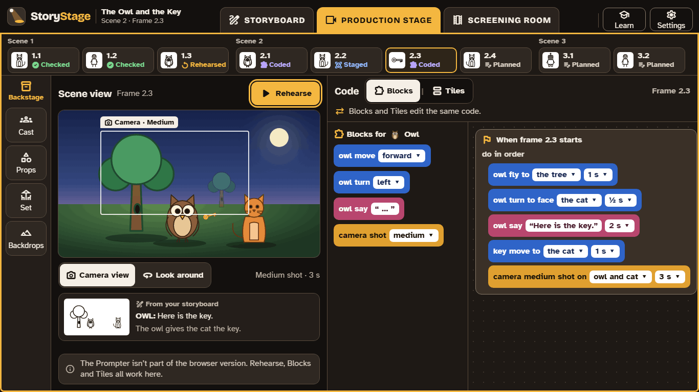

# Get StoryStage

StoryStage is free on every device. The apps include the optional Prompter; the browser version doesn't.

**[Open: download links and store listings arrive with the signed builds (WP15.4–15.6, M6). The apps are offered in the UK and US app stores (decision 0043).]**

| Device | How to get it | The Prompter | Voice input |
|---|---|---|---|
| **Windows** 10 or 11 | Download the installer **[link]** | Yes | Yes |
| **Mac** (macOS **[version]** or later) | Download the app **[link]** | Yes | Yes |
| **iPad** (iPadOS **[version]** or later) | The App Store **[link]** | Yes | Yes |
| **Chromebook** that can run Android apps | Google Play **[link]**; schools can use managed Google Play | Yes | Yes |
| **Any other device**, or a Chromebook where Android apps are blocked | The browser version at **app.storystage.org** in an up-to-date Chrome, Edge, Safari or Firefox | No | No |

## What you need

- **A screen at least 1024 pixels wide.** That means a laptop, a Chromebook, or an iPad held sideways. On a narrower window StoryStage asks you to turn the iPad or widen the window.
- **3D graphics (WebGL 2),** which every recent laptop, Chromebook and iPad has. StoryStage is tested on a 4 GB Chromebook and a standard iPad, not just fast computers.
- **The internet only for some things:** the apps work offline, except the Prompter, and the one-off download of the speech model the first time voice input is used. The browser version needs the internet to open.

## The browser version

The browser version is the same StoryStage, run from this website: the Storyboard, the Production stage, the Screening room, Backstage, both code editors, the automatic check and MP4 export all work. It leaves out the Prompter and voice input, so it needs no Claude account and no set-up. It is the quickest way to try StoryStage, and it works where a school doesn't allow apps.

## For schools

- **Install through device management:** your usual tools (for example Microsoft Intune, Jamf or the Google Admin console) can push the apps to class devices and set the school lock. [The school lock](set-up.md#the-school-lock)
- **Chromebooks:** if your school blocks Android apps, use the browser version; it needs nothing installed.
- **Updates:** schools will be able to choose a pilot or a stable channel, and hold a version through a term. **[Open: details with the release (WP15.7).]**

## Older versions

StoryStage 1, the earlier version built on Alice 3, is still used in the pilot schools until StoryStage 2 replaces it. **[Open: link to StoryStage 1's page, if it is kept.]**
