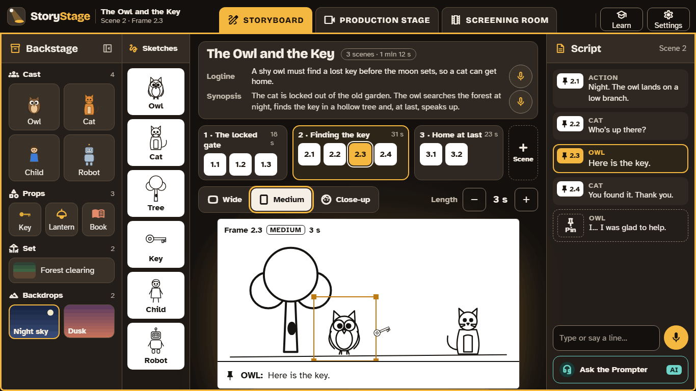

# Make 3D animated films the way film-makers do

StoryStage is a free film studio for learners aged 6 to 13. They plan a film on a storyboard, build and code each scene in 3D, then watch it, check it and share it, in the same order a film studio works.

## Three steps, like a real film

1. **Storyboard.** Learners write a title, a one-line logline and a short synopsis, choose a story shape (a 3-part or 5-part story, a traditional tale, a myth, a scene from a play, or an explanation), and plan each scene in sketched frames with the script beside them.
2. **Production stage.** They set the scene with characters, props and scenery from **Backstage**, then code what happens: who moves, who speaks, what happens at the same time. Code is drag and drop, in **Blocks** or **Tiles**, so there are no typing mistakes to fix.
3. **Screening room.** They watch the whole film, compare it with the storyboard, run the automatic check, and export an MP4 with a title, captions and credits.

A scene's code opens only once it has been storyboarded: plan first, then build.

## Made for classrooms

- **Free,** with no accounts, no adverts and no tracking. StoryStage has no server, and nothing a learner makes is sent to us.
- **Works on the devices schools have:** Windows, Mac, iPad and Chromebook apps, and a browser version for any other device. [Get StoryStage](download.md)
- **Fits the curriculum** in England, Scotland, Wales and Northern Ireland: computing, English and literacy, drama, and more. [For teachers](teacher-guide/index.md)
- **Accessible:** everything works from the keyboard, speech always has captions, and text can be made larger.

## The Prompter: an optional AI helper

The apps include **the Prompter**, an AI helper that coaches and, if asked, suggests a plan in plain words before anything is built. It never writes the learner's story. It is off until an adult sets it up with their own Claude account, and a teacher chooses how much of it each class can use. Everything else in StoryStage works without it. [How to set it up](set-up.md)

## Find out more

- [Get StoryStage](download.md)
- [Getting started](set-up.md)
- [The teacher guide](teacher-guide/index.md)
- [Privacy](privacy.md)
- [Credits](credits.md)

**[Open: the pilot runs in schools in spring 2027 (WP19). Until the first release, this page says "coming soon" where it links to downloads.]**
