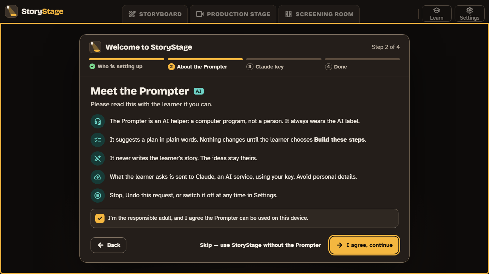
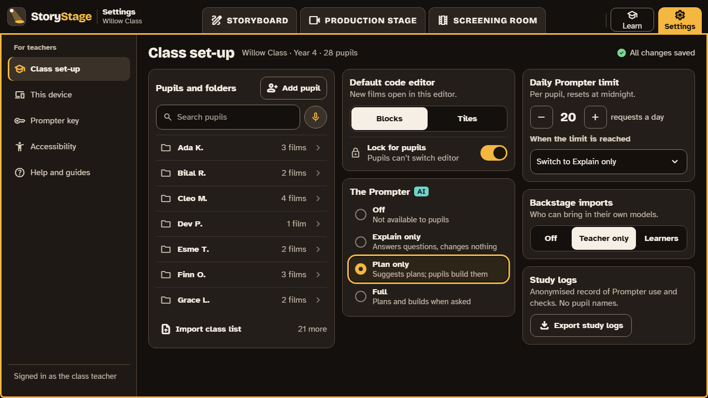

# Getting started

There are three ways to start. Pick the one that fits.

- [A learner, on their own or at home](#a-learner-on-their-own): start making films straight away.
- [An adult adding the Prompter](#an-adult-adding-the-prompter): the optional AI helper, with your own Claude key.
- [A school or club](#a-school-or-club): set up a class, and lock the settings.

## A learner on their own

The first time StoryStage opens, it asks who is setting it up. Choose **I'm a learner**, and you go straight to your first film. Everything works without the Prompter. An adult can add it later in Settings.

**Learn** (top right) has short guided films that walk through the first steps, and tips that appear the first time you use something.

## An adult adding the Prompter

The Prompter is an AI helper in the apps. It coaches, and when a learner asks it to, it suggests a plan in plain words; nothing changes until the learner chooses **Build these steps**. It never writes the learner's story.

It runs on **Claude**, an AI service from Anthropic, using **a Claude key from an adult's own account**. The adult who sets it up is Anthropic's customer, and pays Anthropic for what the Prompter uses. StoryStage gets nothing, and never sees the requests.

### Before you start

You need to be **18 or over**. A learner can never hold or enter the key.

**[Open: whether a parent at home may hold the key is being confirmed with Anthropic (WP17.5). Until it is, this section is for teachers and club leaders; parents follow once Anthropic confirms.]**

### Step 1: get a Claude key

1. Sign up at Anthropic's **Claude Console [link]**. Anthropic calls the key an "API key".
2. Add credit or billing.
3. Create a workspace called "StoryStage", and **set a monthly spend limit** on it. This is the real cap on what you can be charged.
4. Create a key in that workspace. Copy it straight away: the Console shows it only once.

Keep the key private, as you would a password. Never put it in an email, a document or a chat.

### Step 2: add it to StoryStage

1. On the device, open StoryStage and choose **I'm the adult who owns the Claude key** (or go to **Settings › Prompter key** later).
2. Read **Meet the Prompter** with the learner if you can, then tick the box to agree.
3. Paste the key and choose **Save key and continue**. StoryStage checks it.

The key is kept in the device's own secure store (Windows Credential Manager, the Mac and iPad Keychain, or the Android Keystore). It never appears on screen again, and it is never saved in films, exports or study logs. To remove it, go to **Settings › Prompter key › Remove key**; the Prompter switches off.

### What the Prompter sees

When a learner asks the Prompter something, StoryStage sends Anthropic the request and what the Prompter needs to answer it, all as text: the storyboard, the script and the code. **It never sends camera pictures, microphone audio or images.** Voice input is turned into text on the device, and the audio is thrown away. Anthropic doesn't use what it receives to train its models. More in [Privacy](privacy.md).

## A school or club

**[Open: how the Prompter reaches a whole class (WP24.3, M1). For the pilot, the Prompter runs where an adult who owns the key is working with a small group or club (route A). This section gains the class options when that is decided.]**

### Class set-up

Teachers set each class up in **Settings › Class set-up**:

| Setting | Choices | What it does |
|---|---|---|
| **Default code editor** | Blocks or Tiles; **Lock for pupils** | The editor pupils see first, and whether they can switch |
| **The Prompter** | Off, Explain only, Plan only, Full | How much of the Prompter pupils get ([the four levels](teacher-guide/05-the-prompter.md)) |
| **Daily Prompter limit** | Requests per pupil per day, and what happens at the limit (for example, switch to Explain only) | Keeps use, and cost, in hand |
| **Backstage imports** | Off, Teacher only, Learners | Who may bring their own 3D models in |
| **Study logs** | Export | A record of Prompter use and checks for the pilot study, with no pupil names |

**[Open: where each pupil's work lives between lessons on shared devices (WP24.2). The class's pupil folders follow that decision.]**

### The school lock

IT managers can fix the settings so they can't be changed on the device: with a policy file on Windows and Mac, and through device management on iPad and Android Chromebooks (managed app configuration). A lock set this way overrides the class set-up, for example to keep the Prompter off during an exam.

| Setting | In plain words |
|---|---|
| `prompter.enabled` | The Prompter on or off |
| `prompter.explainOnly` | Explain only: explanations and the story coach, no plans |
| `prompter.planOnly` | Plan only: plans, but pupils build every block themselves |
| `prompter.dailyCap`, `prompter.capAction` | The daily limit, and what happens when it is reached |
| `prompter.voiceInput` | Voice input to the Prompter on or off |
| `editor.default`, `editor.locked` | The default code editor, and whether pupils can switch |
| `backstage.import` | Who may import models: off, teacher, learners |
| `backstage.search` | An optional search of free (CC0) models; off |
| `storyboard.allowImportedWithoutStoryboard` | Let imported Alice worlds be coded before they are storyboarded |
| `study.enabled` | Study logs for the pilot study |
| `update.channel`, `update.pin` | Pilot or stable updates, and holding a version through a term |

If the policy can't be read, the Prompter stays off. **[Open: the file's location and format, and a managed-configuration example for each platform (WP15.3, spec 05).]**

## Something wrong?

**Report a problem** (in Settings) makes a bundle you can attach to the feedback form: the versions, the self-test result and the settings in force, with the key and personal details removed. Nothing is sent automatically. If the Prompter ever says something worrying, stop, keep a note of it, and follow your school's safeguarding procedure. **[Open: the feedback form and contact address (WP19.4).]**
