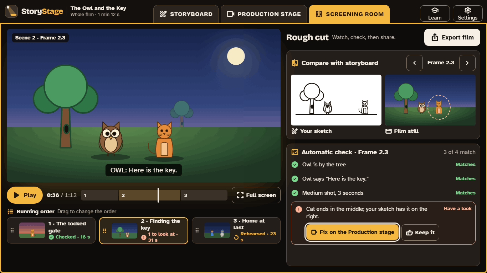

# 1. The three tabs

StoryStage has three tabs, always in the same order along the top. They follow how films are really made: plan, build, then watch and share. **Learn** and **Settings** sit apart on the right.

## Storyboard: plan the film

Learners:

- write the **title**, a one-sentence **logline** (who wants what, and what stands in the way) and a short **synopsis**;
- choose a **story shape** (3-part, 5-part, or a curriculum template such as a traditional tale; see [The curriculum](08-curriculum.md));
- add **scene cards**, each with a heading (place and time) and the characters in it;
- build each **frame** by dragging black-and-white sketches onto it, choose the **shot** (Wide, Medium or Close-up) and its length;
- write the **script**, pinning each line to the frame where it is said.

Backstage sits on the left, so learners can find the characters, props and scenery their story needs while they plan.

## Production stage: build and code each frame

Learners:

- **set the stage:** the first time a scene opens, StoryStage offers to place the cast, props, scenery and camera from the storyboard;
- **code** what happens in each frame, in Blocks or Tiles ([The code editors](03-code-editors.md));
- **Rehearse** to watch the frame play, and fix it until it does what they planned.

Each frame shows its progress as a word and an icon: **Planned** (it has a storyboard frame), **Staged** (the actors are placed), **Coded**, **Rehearsed** (played since its last change) and **Checked** (it passed the automatic check, or its flags were kept). Changing a frame's code moves it back to Coded.

## Screening room: watch, check, share

Learners watch the rough cut of the whole film, compare each frame with its storyboard, run the **automatic check**, and **export** an MP4 film. [The Screening room](04-screening-room.md)

## Learn

**Learn** opens short **guided films**: step-by-step activities that check each step against the learner's real production, with **Show me where** to point at the right control. **Tips** appear the first time each control is used, and can be switched off or read aloud. Guided films work with or without the Prompter.

The first guided films are: Plan your first frame; Make the owl speak; Same code, new look (Tiles); Check and export your film.
