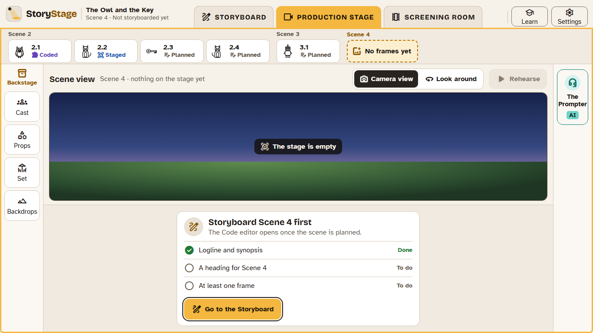

# 2. Storyboard first

In StoryStage, **a scene's code stays closed until the scene has been storyboarded.** Learners need:

- a **logline** and a **synopsis** for the film;
- a **heading** for the scene (place and time);
- at least one **frame** in the scene.

Until then, the Production stage says, in plain words, what is still to do, with a button to **Go to the Storyboard**.

## Why

- **It's how films are made.** Studios storyboard before they animate, because changing a plan is cheaper than changing a finished scene.
- **It's how programs are made.** The storyboard is the specification: what should be on screen, who says what, and how long it lasts. Coding becomes "make it match the plan", and the automatic check can tell learners where it doesn't. Every UK curriculum asks for this: plan, build, test, improve.
- **It keeps the story the learner's.** The ideas are settled in their own words before any code, or any help from the Prompter, is involved.

## Sketches, not drawings

Frames are built from **sketches**: black-and-white drawings of every model in Backstage, from four sides and in a few poses. Learners drag them onto the frame and place them. They can't paste in pictures from elsewhere. This keeps the storyboard quick to make, means every sketch stands for something that can actually go on the stage, and avoids copyright problems with pictures from the internet.

## When a character isn't in Backstage

Learners can search all of Backstage from the sketch library. If what they need isn't there:

- if the class allows imports, a teacher (or the learner) can import a model ([Backstage and licences](07-backstage-and-licences.md));
- otherwise the learner places a **stand-in**: a labelled outline ("dragon") that works on frames and on the stage. If the real model arrives later, it replaces the stand-in, and the code keeps working.

## Set the stage

The first time a scene is opened on the Production stage, StoryStage offers to **set it up from the storyboard**: place the characters, props, scenery, backdrop and camera as the frames show. Learners can choose what to place, and move anything afterwards. It's one step, so **Undo** removes it all.

## Imported Alice worlds

A school can let learners code a world imported from Alice before it has a storyboard (the setting `storyboard.allowImportedWithoutStoryboard`). Every new production still starts with the Storyboard.
