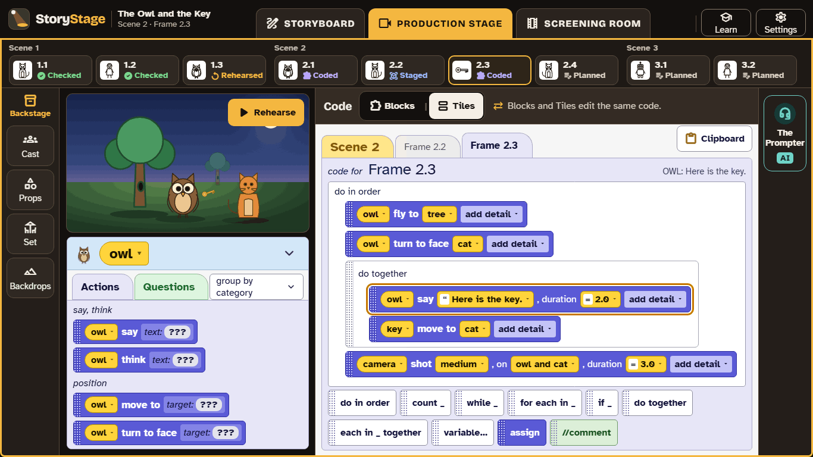

# 3. The code editors

StoryStage has two code editors. They show **the same code** in two ways, and learners can switch at any time without losing anything.

| | Blocks | Tiles |
|---|---|---|
| **Looks like** | Blocks that snap together, made with Blockly (the engine behind many block editors) and styled like Alice's tiles | Rows of tiles in a structured list, as in Alice |
| **Good for** | Learners who know block coding already | Seeing the structure of a program, and longer programs |
| **Both** | Drag and drop, so no typing errors; full keyboard control; the same actions, loops and events | |

The first time a learner switches, StoryStage explains that the program stays the same, "like one story in a picture book or a chapter book". Teachers set the **default editor** for each class, and can **lock** it ([Class set-up](06-class-set-up.md)).

**The pilot study.** In the pilot, StoryStage studies which editor works better for which learners (WP19.5). Your class may be given one default, and another class the other. The study measures what learners achieve, not just which they prefer.

## What learners code

Each character has **actions** (move, turn, turn to face, say, think, and moving parts of the body such as the head or an arm) and **questions** (how far away something is, whether it can be seen). Learners combine them with:

- **do in order** and **do together** (actions at the same time);
- **count** (repeat a number of times), **while**, and **for each**;
- **if** (a choice);
- **variables**, and their own named actions;
- **events**: when the frame starts, when something is clicked, when a key is pressed.

These are the ideas the computing curricula ask for at primary and early secondary: sequence, repetition, selection, variables, and decomposition. Learners meet them by making characters act.

## The text view

A **text view** shows the same program as text, in a style like Python, and lights up each line as it runs. Learners can't type in it. It's a bridge to text programming at KS3 and beyond, not a replacement for it.

## Rehearse

**Rehearse** plays the current frame. Encourage learners to **predict before they press it**: "What will the owl do?" Then compare. Each block lights up as it runs, so they can see where it went wrong, and **Undo** names each step ("Make owl say Hello"), so going back is easy.

## Keyboard and accessibility

Every drag has a keyboard alternative: select a tile or block, choose **Move to…**, and pick the place with the arrow keys. [Accessibility](09-accessibility.md)
