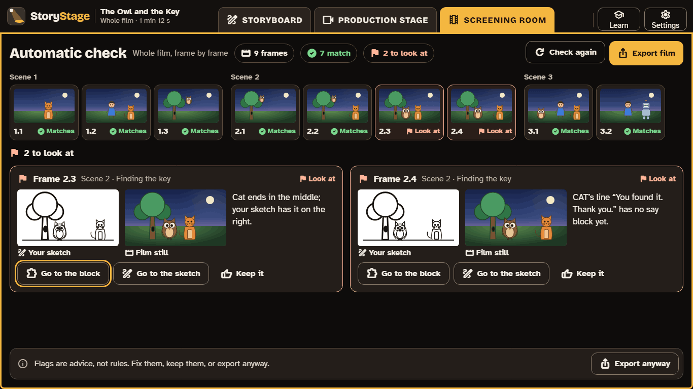
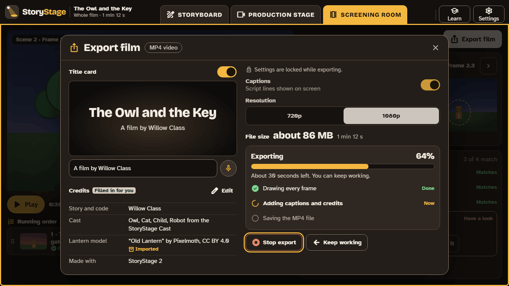

# 4. The Screening room

The Screening room is where a film comes together: learners watch the rough cut, check it against their plan, and export it to share. There is no Prompter and no Backstage here; it is for watching and checking.

## The rough cut

The player shows the whole film, scene by scene, with transitions and captions. Learners can reorder scenes by dragging them in the **running order**.

## Compare with the storyboard

For each frame, StoryStage shows the storyboard sketch beside the matching still from the film, so learners can see at a glance whether the film matches the plan.

## The automatic check

The **automatic check** compares every frame with its storyboard and says, in plain words, where they differ:

- who is on screen, and whether they are on the left, centre or right;
- the shot (Wide, Medium or Close-up), and the length;
- whether each scripted line has a block that says it.

Each result is **Matches** or **Look at**. A "Look at" flag links to the block and to the sketch, and learners can fix it or **Keep it**: flags are advice, not rules. The check needs no Prompter and no internet, so it works in every version.

**Why it matters for teaching:** the check turns "debug your program" into "make it match your plan". It is the single feature that serves most curriculum statements across the four nations ([The curriculum](08-curriculum.md)). Use it at the end of every coding lesson.

## Feedback between learners

The Screening room has **notes**: pairs can watch each other's films and leave a note on a scene, such as one strength and one thing to improve. Acting on a note, and saying why, is good evidence for the "evaluate and improve" statements in every curriculum.

## Export

**Export film** makes an MP4, 720p or 1080p, with:

- a **title card** ("A film by Willow Class");
- **captions** from the script;
- **credits**, filled in automatically: the learners' credits, and the makers of every model that needs crediting.

Export runs in the background, and learners can keep working.

- **Names in credits:** use first names or initials, as your school's policy allows. Sharing a film outside school follows your school's consent arrangements.
- **Licences can block public export.** If a film uses an imported model with a non-commercial licence, or one marked "not sure", StoryStage allows it in class but blocks export for public sharing, and says why. [Backstage and licences](07-backstage-and-licences.md)
