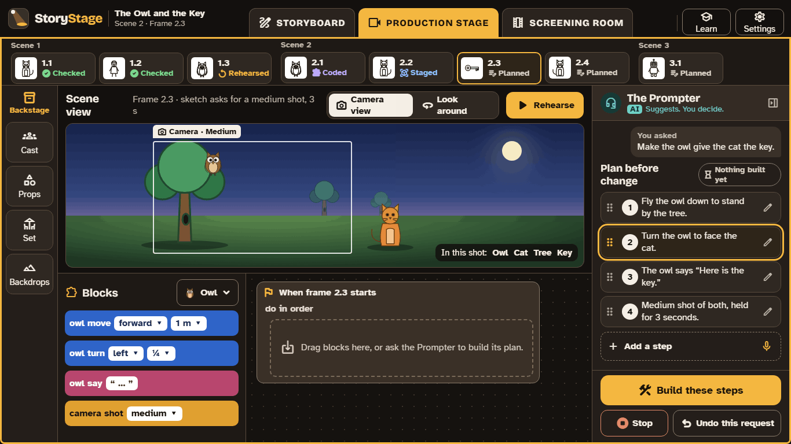

# 5. The Prompter

The Prompter is an **optional AI helper** in the StoryStage apps. It explains, asks questions that help learners plan their stories, and, when asked, suggests a plan for building something. It is not in the browser version, and everything else in StoryStage works without it. None of the curriculum uses depend on it.

## What it never does

- **It never writes the learner's story.** Not the logline, the synopsis, or a line of script. The story coach only asks questions.
- **Nothing changes until the learner says so.** When it suggests building something, it shows a numbered plan in plain words. Learners can reorder, edit, add or delete steps, and nothing is built until they choose **Build these steps**.
- **It never sees pictures or hears voices.** It receives text only: the request, the storyboard, the script and the code.
- **It always says it is an AI.** It wears an "AI" badge everywhere, and its colour is used for nothing else.

Learners can always press **Stop**, and **Undo this request** removes everything a request built, in one step.

## What it can do (the modes)

| Mode | What it does |
|---|---|
| **Explain** | Answers questions about StoryStage and about the learner's code: "What does do together do?" |
| **Story coach** | Asks questions about the logline, synopsis and scenes ("What does the owl want? What stops it?"). It never writes the answers |
| **Show me how** | Makes a plan the learner builds step by step, learning how as they go |
| **Build it** | Makes a plan, and builds it once the learner has checked and chosen **Build these steps** |

## The four levels

Teachers choose one level for each class in **Settings › Class set-up**:

| Level | What learners get | Good for |
|---|---|---|
| **Off** | No Prompter. Learners see a neutral note: "The Prompter is switched off by your school." | Assessments; lessons where learners should work unaided |
| **Explain only** | Explain and the story coach | Younger learners; story planning lessons |
| **Plan only** | As Explain only, plus plans, but learners build every block themselves | Computing lessons: the plan is pseudocode, and learners turn it into code |
| **Full** | Every mode, including Build it | Older learners, and projects where the film matters more than the coding |

A **daily limit** per pupil, and what happens when it is reached (for example, switch to Explain only), keep use and cost in hand. A school lock can fix the level so it can't be changed on the device.

## Who pays, and whose key

The Prompter runs on **Claude**, from Anthropic, using a key from an **adult's own Claude account**. Learners never see or type the key. [Getting started](../set-up.md)

**[Open: how the Prompter reaches a whole class (WP24.3, M1). For the pilot, it runs where the adult who owns the key is working with a small group or club. This section gains the class options when that is decided.]**

## Teaching with it

- **Plan first, then ask.** The Prompter works best once the storyboard is done: it can see what the learner planned.
- **Plan only is a computing lesson in itself.** Learners compare the plan in plain words with the blocks they build: algorithm to code.
- **It can be wrong.** Teach learners to check what it suggests, by rehearsing and running the automatic check. That's a good habit with any AI.
- **No personal details.** Learners shouldn't type names, addresses or other personal information into it, and it is told never to ask.
- **Something worrying?** If the Prompter ever says something inappropriate or upsetting, stop, keep a note of what was asked and said, and follow your school's safeguarding procedure. **Report a problem** in Settings makes a bundle you can send with the feedback form; nothing is sent automatically.
