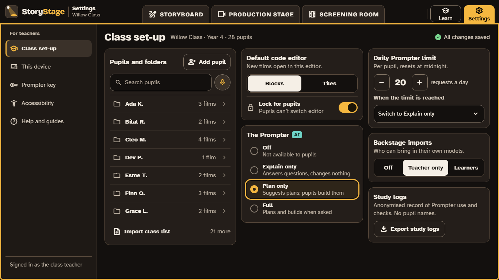

# 6. Class set-up

Teachers set each class up in **Settings › Class set-up**. Changes save as you make them.

| Setting | Choices | Suggested start |
|---|---|---|
| **Default code editor** | Blocks or Tiles; **Lock for pupils** | The editor your class knows; locked for the first lessons, so everyone sees the same thing |
| **The Prompter** | Off, Explain only, Plan only, Full ([the levels](05-the-prompter.md#the-four-levels)) | Off or Explain only, until the class knows StoryStage |
| **Daily Prompter limit** | A number of requests per pupil per day, and what happens at the limit | A low limit, switching to Explain only when it's reached |
| **Backstage imports** | Off, **Teacher only**, Learners | Teacher only (the default) |
| **Study logs** | Export | Only for pilot schools taking part in the study |

## Pupils and their folders

- **Add the class once** in **Settings › Class set-up › Pupils and folders**: first names, or a word and a picture for each pupil. The list stays on the device and never goes into a film, an export or a study log.
- **Each lesson,** a pupil chooses their name and their own work opens. Autosave keeps it there. A pupil sees only their own productions; deleting asks first, and goes to a bin you empty.
- **Pupils on different devices next lesson?** **Collect** the class's work into the school's own storage (a drive, OneDrive or Google Drive), then **Hand back** on the next devices. Collect into a **staff-only folder**, so pupils can't open each other's work there.
- **Shared computer logins:** folders stop slips and casual looking, not a determined pupil looking for files on the computer itself. If your school can give each pupil their own sign-in on the device, use it.
- StoryStage has no accounts and never signs in to Google or Microsoft (decision 0065).

## The school lock

An IT manager can lock any of these settings for the whole school, so they can't be changed on the device, for example to keep the Prompter off during exams. The lock is set with a policy file on Windows and Mac, and through device management on iPads and Chromebooks. The settings and their names are on [Getting started](../set-up.md#the-school-lock).

## Study logs (pilot schools only)

In the pilot, schools taking part in the editor study can export **study logs**: a record of Prompter use and automatic-check results, which the study uses to compare the two code editors. They carry a made-up code for each session instead of a pupil's name. That makes them pseudonymous, not anonymous, so handle them as personal data under your school's data protection policy. Taking part needs consent, as the study's information sheets explain. **[Open: the study design, consent and retention (WP19.5, 19.6, and the DPIA, 17.3).]**

## Running a lesson

**[Open: a page for each step of the teacher's journey (WP24.7): installing through device management, setting the lock, starting a class, pupils returning to their work, collecting films, exporting study logs, and marking. They follow the journey in 24.1.]**

Until then, the [use cases](08-curriculum.md#eight-use-cases) each give a lesson-by-lesson plan.
