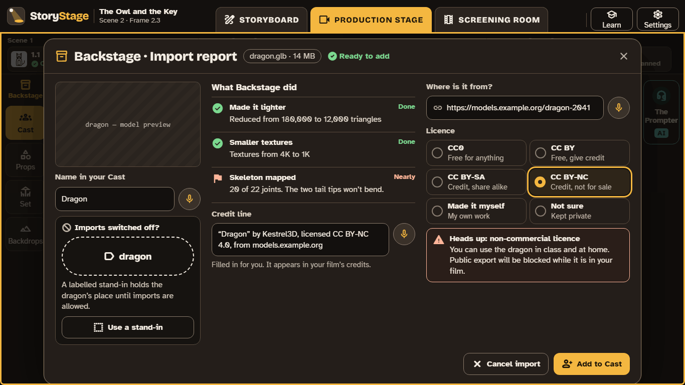

# 7. Backstage and licences

**Backstage** is StoryStage's library of 3D models, in four sections:

| Section | What's in it |
|---|---|
| **Cast** | Anything that can act: people, animals, creatures, the storybook characters |
| **Props** | Things characters pick up, use or ride: objects, tools, vehicles |
| **Set** | Scenery that stays put: buildings, trees, rocks, furniture |
| **Backdrops** | The ground, the sky, lighting and fog |

Search covers all four. The storyboard's sketches mirror Backstage one to one, so every sketch stands for a model that can go on the stage.

## Where the models come from

Every model has a **licence** and a **credit line**, and every film's credits name the makers of the models it uses. The models include everyday people of all ages, a commissioned cast of characters from public-domain stories (myths, legends, fairy tales, Shakespeare), free models from open libraries, and scans of real objects from museums, for history and science.

**Why some characters aren't there:** characters still in copyright (Paddington, Narnia, Roald Dahl's characters, Thomas the Tank Engine), and some whose pictures or names are still protected (Winnie-the-Pooh's drawings, Peter Rabbit), aren't in Backstage. Learners can make their own versions of a story with other characters, or use a stand-in. **[Open: the final list follows the owner's rights decisions on each character (WP17.8).]**

## Importing a model

If the class allows imports (**Teacher only** by default), a 3D file (glTF, GLB, VRM or OBJ) can be brought into the class's Backstage. StoryStage makes it light enough for school devices, maps its skeleton so it can walk and gesture, draws its sketches, and asks **where it's from** and **its licence**:

| Licence | In plain words | In StoryStage |
|---|---|---|
| CC0 | Free for anything | No limits |
| CC BY | Free, but credit the maker | Credited in the film automatically |
| CC BY-SA | Credit, and share alike | Credited |
| CC BY-NC | Credit, not for sale | Allowed in class; **public export is blocked** |
| Made it myself | Your own work | No limits |
| Not sure | We don't know | Kept in class; **public export is blocked** |

Imported models stay in the class's Backstage, never in StoryStage's own catalogue. There is no browsing of model websites inside StoryStage, because those sites aren't designed for children; find models with an adult and import the file.

## Stand-ins

If imports are off, or a model can't be found, learners place a **stand-in**: a labelled outline ("dragon") that works on frames and on the stage, and keeps its code if a real model replaces it. Stand-ins are listed for the teacher.

## Teaching credit and copyright

Licences and credits are part of what learners learn, as they are in the film industry. Wales's Digital Competence Framework names it directly ("digital rights, licensing and ownership"), and every curriculum asks learners to respect other people's work. The use case [Credit where it's due](../../docs/curriculum/use-cases/08-credits-and-copyright.md) is a two-lesson sequence on it.
